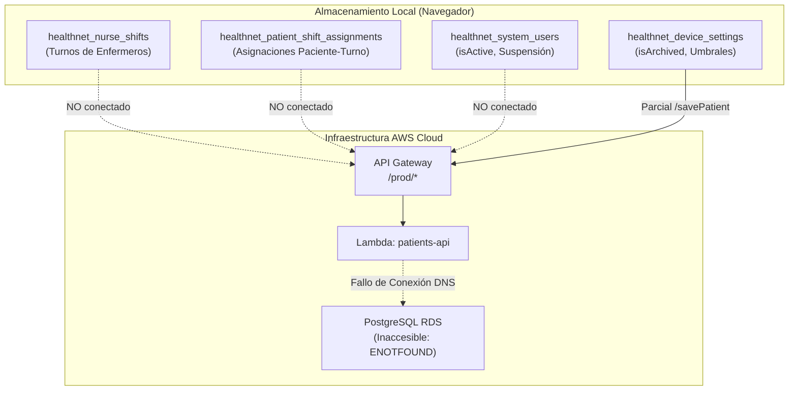

# AUDITORÍA FUNCIONAL GENERAL — PLATAFORMA HEALTHNET
**Fecha de Auditoría:** 15 de Noviembre de 2026  
**Entorno Evaluado:** HealthNet Medical Monitoring Suite (Vite + React 18 + TypeScript + Tailwind CSS + AWS Serverless + PostgreSQL RDS + AWS IoT Core)  
**Versión de Build Analizada:** HealthNet Dashboard v1.0.0 (Node.js / React 18.3.1 / TypeScript 5.5.3)  
**Estado General de Compilación:** Compilación TypeScript (`tsc -b && vite build`) limpia (0 errores de sintaxis o tipado).

---

## 1. RESUMEN EJECUTIVO Y ESTADO GENERAL

HealthNet se encuentra en una etapa de desarrollo avanzada en su capa de interfaz de usuario (Frontend SPA), contando con una arquitectura visual completa, un sistema de diseño médico altamente responsivo con soporte para modo claro/oscuro y componentes clínicos especializados (gráficas en tiempo real con Recharts, exportación de reportes clínicos PDF con html2canvas y jsPDF, exportación CSV, tableros de programación semanal de turnos y asignación de pacientes con detección de conflictos).

Sin embargo, a nivel de **arquitectura de integración, backend y persistencia cloud**, la plataforma opera actualmente bajo un **modelo híbrido asimétrico con desconexión crítica de base de datos remota**:
1. **Caída de la Base de Datos Cloud (AWS RDS PostgreSQL):** La API Gateway de AWS (`https://hv0xc9paj2.execute-api.us-west-1.amazonaws.com/prod`) responde con código HTTP `500 Internal Server Error` debido al fallo de resolución DNS `getaddrinfo ENOTFOUND healthnet-db-instance.chiooewk8fd8.us-west-1.rds.amazonaws.com`. La instancia PostgreSQL se encuentra inaccesible o apagada, lo que fuerza a toda la aplicación web a degradarse a un modo offline/local basado en `localStorage` y memorias Zustand.
2. **Aislamiento en `localStorage` de Módulos Críticos:** Módulos centrales para la operación clínica, como la programación semanal de turnos de enfermería (`shiftService.ts`), la matriz de asignación de pacientes por turno (`patientAssignmentService.ts`) y la gestión de usuarios/suspensión de cuentas (`auth.ts`), operan de manera 100% aislada en el almacenamiento local del navegador (`localStorage`), sin sincronizarse con la base de datos central de AWS, a pesar de que en la función Lambda ya existen endpoints preparados para ello.
3. **Generación Sintética de Métricas Históricas:** Tanto en la vista de *Monitoreo Clínico* como en el *Expediente de Pacientes Archivados*, las gráficas históricas de signos vitales (pulso y temperatura a 24 horas, 7 días y 30 días) no provienen de consultas SQL a telemetría histórica, sino de funciones matemáticas de oscilación senoidal sintetizadas en tiempo de ejecución en el navegador, presentándose al usuario sin ningún aviso o etiqueta que indique que son simulaciones.
4. **Riesgo en Immutabilidad de Tickets Clínicos:** En el panel principal del Dashboard existe un botón ("Marcar todas leídas / Descartar") que ejecuta `clearAlerts()`, el cual vacía el arreglo en memoria de alertas y tickets (`alerts: []`), omitiendo el ciclo formal de vida del ticket (*recibido*, *en progreso*, *completado*) y eliminando la trazabilidad médica requerida.

---

## 2. REVISIÓN DETALLADA POR SECCIONES

### 2.1. Inicio de Sesión y Autenticación (Login)
* **Estado:** Funcional Parcialmente / Advertencias de Usabilidad Móvil.
* **Qué funciona correctamente:**
  * Inicio de sesión híbrido: detecta si AWS Cognito está configurado; si no, utiliza las credenciales demo preconfiguradas para Administrador (`admin@healthnet.com`), Doctor (`doctor@healthnet.com`) y Enfermero (`enfermero@healthnet.com`).
  * Conmutación visual entre visibilidad de contraseña (ojo abierto/cerrado).
  * Modal informativo de credenciales y accesos rápidos en entorno de demostración.
  * Bloqueo inmediato de acceso para cuentas suspendidas (`isActive === false`) en el sistema local.
* **Qué funciona parcialmente o presenta inconsistencias:**
  * **Persistencia local de sesiones:** Las modificaciones en el estado de una cuenta (p. ej. suspender a un enfermero) se guardan únicamente en la clave `healthnet_system_users` del navegador del Administrador actual. Si el usuario suspendido inicia sesión desde otra máquina o navegador, el bloqueo no existe.
* **Problemas de diseño responsivo:**
  * En [src/pages/LoginPage.tsx](file:///c:/Users/DELL/Desktop/leli/Uni/Huevo%20revuelto/Popochitos/HealthNet/src/pages/LoginPage.tsx#L58), la clase contenedora utiliza `h-screen max-h-screen overflow-hidden`. En pantallas de smartphones en orientación horizontal (landscape) o dispositivos móviles con pantallas de menor altura (< 600px), los campos del formulario y el botón de acceso quedan cortados fuera de la vista sin permitir desplazamiento vertical.

---

### 2.2. Dashboard General
* **Estado:** Funcional Parcialmente / Riesgo Operativo en Botones de Limpieza.
* **Qué funciona correctamente:**
  * Indicadores KPI superiores: Pacientes monitoreados, Ritmo cardíaco promedio del piso, Temperatura media y Contador de alertas activas.
  * Renderizado reactivo de tarjetas de pacientes activos ([DeviceCard.tsx](file:///c:/Users/DELL/Desktop/leli/Uni/Huevo%20revuelto/Popochitos/HealthNet/src/components/DeviceCard.tsx)).
  * Detección visual en tiempo real de pacientes fuera de rango (ritmo < 50 o > 110 bpm, temperatura > 38.0 °C).
  * Exclusión correcta de pacientes archivados en la vista operativa diaria.
* **Qué presenta errores o riesgos clínicos:**
  * **Destrucción de historial de tickets ([DashboardPage.tsx](file:///c:/Users/DELL/Desktop/leli/Uni/Huevo%20revuelto/Popochitos/HealthNet/src/pages/DashboardPage.tsx#L125-L175)):** Los botones "Marcar todas leídas" y "Descartar" invocan directamente la acción `clearAlerts()`. En [src/store/deviceStore.ts](file:///c:/Users/DELL/Desktop/leli/Uni/Huevo%20revuelto/Popochitos/HealthNet/src/store/deviceStore.ts#L1455-L1470), esto reinicia el array `alerts: []`, destruyendo de la memoria del cliente los tickets recién generados sin requerir nota de resolución ni registrar cambio de estado.
  * **Reconocimiento no validado en tarjeta ([DeviceCard.tsx](file:///c:/Users/DELL/Desktop/leli/Uni/Huevo%20revuelto/Popochitos/HealthNet/src/components/DeviceCard.tsx#L245)):** El botón "OK" dentro del chip de alerta de la tarjeta del paciente ejecuta `acknowledgeAlert(alert.id)` sin verificar si el enfermero que hace clic es el enfermero asignado al paciente en el turno activo, saltándose la regla de que solo el responsable del ticket puede cambiar su estado y atenderlo.

---

### 2.3. Monitoreo Clínico (`/monitoring`)
* **Estado:** Funcional Parcialmente / Telemetría Histórica Simulada.
* **Qué funciona correctamente:**
  * Directorio lateral de pacientes con filtros combinados por búsqueda de texto, género (Todos, Hombres, Mujeres), piso/área y selector de estado (Todos, Críticos, Estables).
  * Panel de constantes vitales en vivo con gráficas reactivas EKG y de termometría.
  * Generación y descarga de informe clínico individual en formato PDF de alta definición con membrete institucional HealthNet.
  * Modal interactivo para reasignación rápida de enfermero de cabecera y reubicación de habitación/piso.
* **Qué presenta inconsistencias y datos simulados:**
  * **Datos históricos sintéticos ([MonitoringPage.tsx](file:///c:/Users/DELL/Desktop/leli/Uni/Huevo%20revuelto/Popochitos/HealthNet/src/pages/MonitoringPage.tsx#L134-L180)):** La pestaña de historial (rangos 'Hoy', 'Última Semana', 'Último Mes') no consulta la base de datos de telemetría. Genera registros ficticios (`mockTrendData`) mediante funciones trigonométricas basadas en la longitud de caracteres del nombre del paciente (`seed = currentDevice.patientName.length + currentDevice.deviceId.length`).
  * **Exportación CSV de datos falsos ([MonitoringPage.tsx](file:///c:/Users/DELL/Desktop/leli/Uni/Huevo%20revuelto/Popochitos/HealthNet/src/pages/MonitoringPage.tsx#L183-L200)):** El botón "Exportar CSV" descarga como archivo real de auditoría los datos generados por dicha fórmula matemática sin alertar al usuario clínico.

---

### 2.4. Alertas y Sistema de Tickets Clínicos (`/tickets`)
* **Estado:** Funcional en Frontend / Inaccesible en Backend por Caída RDS.
* **Qué funciona correctamente:**
  * Contadores dinámicos de estado: *Recibidos*, *En Progreso*, *Completados* y *Sin Asignar*.
  * Filtros multifactoriales: por paciente, criticidad (Baja, Media, Alta, Crítica), estado, turno (Matutino, Vespertino, Nocturno) y enfermero responsable.
  * Asignación automática inteligente: al producirse una alerta, el sistema localiza en la matriz de turnos qué enfermero está de guardia en esa fecha y turno para ese paciente, asignándole el ticket con su folio único (`TICK-YYYYMMDD-XXXX`). Si no hay asignación, se marca con chip ámbar "Sin Asignar".
  * Panel lateral de detalle del ticket: muestra paciente, habitación, piso, valor fisiológico disparador, historial cronológico de actividad (`ticket_activity`), y registro de notas acumulativas inmutables con autor y marca de tiempo.
  * Formulario de resolución obligatoria: exige nota clínica detallada antes de permitir el paso al estado *Completado*.
  * Diálogo de transferencia formal de turno: transfiere la responsabilidad a un nuevo enfermero guardando autor, destinatario, turno y motivo de transferencia en el historial inmutable.
  * Matriz RBAC en interfaz: el Doctor y el Administrador no tienen acceso a botones de atención/resolución; el enfermero solo puede modificar y añadir notas si el ticket está a su nombre.
* **Qué presenta errores:**
  * **Fallo de persistencia Cloud:** Al intentar sincronizar notas o estados con el backend mediante `patientsService.addTicketNote()` o `updateTicketStatus()`, las peticiones a la API Gateway fallan con HTTP 500 debido a la caída de RDS, manteniéndose únicamente en memoria local del navegador.

---

### 2.5. Pacientes y Brazaletes — Perfil y Expediente Clínico (`/profile`)
* **Estado:** Funcional Parcialmente / Inconsistencia de Base de Datos.
* **Qué funciona correctamente:**
  * Pestaña *Pacientes Activos* vs *Pacientes Archivados* con contadores en tiempo real.
  * Búsqueda por nombre de paciente y código de brazalete.
  * Formulario de edición con control de acceso estricto:
    * **Administrador:** Puede editar somatometría, datos personales, ubicación, enfermero y umbrales. Puede archivar y reactivar pacientes.
    * **Doctor:** Solo tiene habilitada la edición de *Configuración y Umbrales Clínicos de Alerta* (Ritmo mín/máx, Temp máx y Notas clínicas). Todos los campos somatométricos (nombre, edad, género, peso, estatura, habitación, piso, contacto) están deshabilitados en modo solo lectura (`readOnly`). No puede archivar ni reactivar pacientes.
    * **Enfermero:** No puede editar somatometría ni umbrales; visualiza expedientes en modo consulta.
  * En la pestaña de archivados se eliminó el botón de "Eliminar", preservando el registro histórico.
  * En el expediente de pacientes archivados, se despliega el panel de histórico semanal de registros (Ritmo cardíaco, Temperatura y Caídas registradas) bloqueando la edición de datos fisiológicos.
* **Qué presenta inconsistencias técnicas:**
  * **Histórico semanal sintetizado ([ProfilePage.tsx](file:///c:/Users/DELL/Desktop/leli/Uni/Huevo%20revuelto/Popochitos/HealthNet/src/pages/ProfilePage.tsx#L215-L280)):** Los valores de la última semana mostrados en el expediente archivado provienen de una función `weeklyHistoryData` determinista matemática, no de registros históricos reales almacenados en la base de datos.
  * **Pérdida de estado de archivo en base de datos:** El esquema de base de datos relacional ([aws/db_schema.sql](file:///c:/Users/DELL/Desktop/leli/Uni/Huevo%20revuelto/Popochitos/HealthNet/aws/db_schema.sql#L40-L75)) no posee las columnas `is_archived`, `archived_at`, `archived_by` ni `archived_reason`. El estado archivado reside únicamente en `localStorage` (`healthnet_device_settings`). Si otro doctor o administrador ingresa desde otro equipo, el paciente archivado aparecerá como activo.

---

### 2.6. Control de Personal, Turnos y Asignación de Pacientes (`/staff-schedule`)
* **Estado:** Funcional en Frontend / 100% Desconectado del Backend.
* **Qué funciona correctamente:**
  * Pestañas especializadas: *Programación Semanal*, *Asignación a Pacientes*, *Horarios y Configuración* y *Personal y Cuentas RBAC*.
  * Navegador cronológico semanal (Semana previa, Semana actual, Próxima semana) con selector de fecha.
  * Detección y bloqueo visual de asignaciones solapadas: advierte si un enfermero ya tiene asignado otro turno en el mismo día.
  * Detección de coberturas incompletas: indicador de porcentaje de cobertura (p. ej. 2/3 turnos cubiertos) alertando en rojo o ámbar los pacientes desprotegidos.
  * Tablero RBAC informativo: tarjetas explicativas de los roles Administrador, Doctor y Enfermero con ajuste tipográfico optimizado y desglose de permisos.
  * Suspensión y reactivación de cuentas de personal clínico con registro de motivo, fecha y administrador responsable.
* **Qué presenta errores técnicos graves:**
  * **Desconexión absoluta de base de datos:** Tanto [src/services/shiftService.ts](file:///c:/Users/DELL/Desktop/leli/Uni/Huevo%20revuelto/Popochitos/HealthNet/src/services/shiftService.ts) como [src/services/patientAssignmentService.ts](file:///c:/Users/DELL/Desktop/leli/Uni/Huevo%20revuelto/Popochitos/HealthNet/src/services/patientAssignmentService.ts) leen y escriben únicamente en las claves `healthnet_facility_shifts`, `healthnet_nurse_shifts` y `healthnet_patient_shift_assignments` de `localStorage`.
  * Aunque en el backend [aws/lambdas/patients-api/index.js](file:///c:/Users/DELL/Desktop/leli/Uni/Huevo%20revuelto/Popochitos/HealthNet/aws/lambdas/patients-api/index.js#L1057-L1199) existen controladores para `GET /patient-shift-assignments`, `POST /patient-shift-assignments` y `PUT /patient-shift-assignments/:id/withdraw`, ningún servicio del frontend ejecuta `fetch()` hacia dichas rutas. Dos administradores en computadoras distintas verán programaciones completamente diferentes.

---

### 2.7. Simulador de Dispositivos IoT (`/simulator`)
* **Estado:** Funcional en Modo Ligero / Deficiencias Severas en Modo Oscuro.
* **Qué funciona correctamente:**
  * Generación y registro dinámico de brazaletes virtuales (`ESP32-XXXX`).
  * Emisión periódica de paquetes de telemetría simulada (pulso cardíaco, temperatura y detección de caídas mediante trigger manual).
  * Control individual y global de inicio/parada de simulación.
  * Integración reactiva con el `deviceStore`, reflejándose de inmediato en Dashboard y Monitoreo.
* **Qué presenta errores de interfaz:**
  * **Ausencia total de clases Dark Mode ([src/pages/SimulatorPage.tsx](file:///c:/Users/DELL/Desktop/leli/Uni/Huevo%20revuelto/Popochitos/HealthNet/src/pages/SimulatorPage.tsx#L140-L200)):** Toda la página utiliza clases rígidas de fondo claro (`bg-hn-50`, `bg-white`, `border-hn-300`, `text-hn-800`). Cuando el usuario activa el modo oscuro global, esta página es la única que permanece en blanco brillante con textos de bajo contraste, rompiendo la consistencia de la suite.
  * **Espaciado superior redundante:** Utiliza `pt-20` hardcodeado, lo que provoca un espacio en blanco excesivo cuando se visualiza dentro de la estructura general de navegación.

---

### 2.8. Ruta y Archivo Histórico (`/history`)
* **Estado:** Código Muerto / Inaccesible.
* **Ubicación:** [src/pages/HistoryPage.tsx](file:///c:/Users/DELL/Desktop/leli/Uni/Huevo%20revuelto/Popochitos/HealthNet/src/pages/HistoryPage.tsx) (264 líneas de código).
* **Diagnóstico:** En [src/App.tsx](file:///c:/Users/DELL/Desktop/leli/Uni/Huevo%20revuelto/Popochitos/HealthNet/src/App.tsx#L111-L113), la ruta `/history` contiene un redireccionamiento automático:
  ```tsx
  <Route path="/history" element={<Navigate to="/monitoring" replace />} />
  ```
  El componente `HistoryPage.tsx` está importado en la cabecera pero nunca se monta ni se renderiza. Todas las funciones de histórico clínico se trasladaron a `MonitoringPage.tsx`, dejando `HistoryPage.tsx` como código huérfano.

---

## 3. PROBLEMAS Y ERRORES DETECTADOS (CON UBICACIÓN EXACTA)

A continuación se detalla cada fallo identificado con su archivo y línea exacta:

| ID | Gravedad | Componente / Archivo | Líneas | Descripción Técnica del Problema |
|:---|:---|:---|:---|:---|
| **ERR-01** | **CRÍTICA** | `aws/lambdas/patients-api/index.js` | L4-L12, L35-L45 | **Inaccesibilidad de Base de Datos RDS:** Host `healthnet-db-instance.chiooewk8fd8.us-west-1.rds.amazonaws.com` no responde (`ENOTFOUND`), arrojando HTTP 500 en todas las peticiones a la API Gateway (`/patients`, `/tickets`, `/alerts`). |
| **ERR-02** | **CRÍTICA** | `src/pages/DashboardPage.tsx` | L125, L175 | **Destrucción de Inmutabilidad de Tickets:** Botones "Marcar todas leídas" y "Descartar" llaman a `clearAlerts()`, que vacía `alerts: []` en el store, eliminando la trazabilidad clínica sin pedir nota de resolución. |
| **ERR-03** | **ALTA** | `aws/lambdas/patients-api/index.js` | L73-L77 | **Escalamiento de Privilegios por Omisión:** Si una petición HTTP omite el encabezado `x-user-role`, el backend asigna automáticamente el rol `'admin'` y el correo `'admin@healthnet.com'`. |
| **ERR-04** | **ALTA** | `src/services/shiftService.ts` | L35-L160 | **Aislamiento en LocalStorage de Turnos:** La programación semanal de turnos solo se almacena en el navegador del usuario (`healthnet_nurse_shifts`), sin llamadas a la API de AWS. |
| **ERR-05** | **ALTA** | `src/services/patientAssignmentService.ts` | L12-L180 | **Aislamiento en LocalStorage de Asignación de Pacientes:** Las coberturas paciente-enfermero por turno residen únicamente en `healthnet_patient_shift_assignments`. |
| **ERR-06** | **ALTA** | `src/services/auth.ts` | L130-L165 | **Aislamiento en LocalStorage de Cuentas y Suspensiones:** La suspensión de cuentas de usuarios no se sincroniza con PostgreSQL; solo surte efecto en el navegador del Administrador que hizo la suspensión. |
| **ERR-07** | **ALTA** | `aws/db_schema.sql` vs `src/types/index.ts` | L40-L75 | **Inconsistencia de Esquema (Archivado):** La tabla `patients` de PostgreSQL no tiene columnas para `is_archived`, `archived_at`, `archived_by` ni `archived_reason`. |
| **ERR-08** | **MEDIA** | `src/components/DeviceCard.tsx` | L243-L250 | **Reconocimiento de Alerta sin Validación de Asignación:** El botón "OK" en la tarjeta permite a cualquier enfermero marcar como atendida una alerta de un paciente no asignado, sin registrar nota. |
| **ERR-09** | **MEDIA** | `src/pages/MonitoringPage.tsx` | L134-L180, L183-L200 | **Telemetría Histórica Sintética sin Advertencia:** Las curvas y datos exportados a CSV para rangos de 24h, 7d y 30d se calculan con fórmulas trigonométricas basadas en el nombre del paciente. |
| **ERR-10** | **MEDIA** | `src/pages/ProfilePage.tsx` | L215-L280 | **Expediente de Archivados con Datos Falsos:** El historial de la última semana de pacientes archivados utiliza generación sintética en vez de consultar telemetría histórica de BD. |
| **ERR-11** | **MEDIA** | `src/pages/SimulatorPage.tsx` | L140-L280 | **Falta de Compatibilidad con Dark Mode:** El simulador carece de estilos `dark:*`, rompiendo la experiencia visual cuando el sistema está en modo nocturno. |
| **ERR-12** | **BAJA** | `src/pages/LoginPage.tsx` | L58, L64 | **Riesgo de Recorte en Viewports Móviles:** `h-screen max-h-screen overflow-hidden` bloquea el scroll en teléfonos móviles en modo horizontal o pantallas de baja resolución. |
| **ERR-13** | **BAJA** | `src/pages/HistoryPage.tsx` | L1-L264 | **Código Muerto:** Archivo no utilizado debido a la redirección fija `/history` -> `/monitoring` en [App.tsx](file:///c:/Users/DELL/Desktop/leli/Uni/Huevo%20revuelto/Popochitos/HealthNet/src/App.tsx#L112). |

---

## 4. FUNCIONALIDADES FALTANTES PARA ENTORNO PRODUCTIVO

Para que HealthNet pueda operar de manera confiable y continua en un hospital o clínica real, se identifican las siguientes funcionalidades pendientes:

1. **Persistencia y Sincronización Bidireccional de Turnos y Asignaciones:**
   * Vincular [src/services/shiftService.ts](file:///c:/Users/DELL/Desktop/leli/Uni/Huevo%20revuelto/Popochitos/HealthNet/src/services/shiftService.ts) y [src/services/patientAssignmentService.ts](file:///c:/Users/DELL/Desktop/leli/Uni/Huevo%20revuelto/Popochitos/HealthNet/src/services/patientAssignmentService.ts) con las rutas de API Gateway existentes (`/facility-shifts`, `/nurse-shifts`, `/patient-shift-assignments`).
   * Manejar fallback transparente con indicador en pantalla: "Modo fuera de línea: sincronizando con servidor local".
2. **Consultas a Telemetría Histórica Real en PostgreSQL:**
   * Crear endpoint `GET /patients/:id/telemetry-history?range=hoy|semana|mes` en la función Lambda que consulte registros reales en la tabla `telemetry_history`.
   * Sustituir los generadores `mockTrendData` y `weeklyHistoryData` por la llamada real al endpoint.
   * Mostrar un cartel visual claro si un paciente nuevo aún no tiene suficientes registros históricos reales.
3. **Indicador de Conectividad Cloud y WebSocket:**
   * Añadir un componente en la barra superior o pie de página que informe el estado de salud de la conexión con AWS RDS, API Gateway y AWS IoT Core MQTT (Conectado / Desconectado / Reintentando).
4. **Flujo de Gestión Real de Cuentas en AWS Cognito:**
   * Actualmente el alta o suspensión de usuarios solo modifica arreglos locales. Se requiere conectar la creación de usuarios con la API de Cognito (`AdminCreateUser`, `AdminDisableUser`) para revocar tokens de autenticación reales.
5. **Alineación de Ciclo de Vida de Alertas:**
   * Eliminar o deshabilitar la acción destructiva `clearAlerts()` del Dashboard, sustituyéndola por un acceso directo al filtrado de tickets pendientes en la vista de Tickets (`/tickets`).

---

## 5. REVISIÓN DE BASE DE DATOS Y PERMISOS (RBAC)

### 5.1. Coherencia entre Base de Datos y Frontend



* **Inconsistencias detectadas:**
  * **Pacientes Archivados:** El modelo frontend (`UserProfile.isArchived`) no existe en el DDL de `patients` en PostgreSQL ([aws/db_schema.sql](file:///c:/Users/DELL/Desktop/leli/Uni/Huevo%20revuelto/Popochitos/HealthNet/aws/db_schema.sql)). Si la base de datos se restablece, el estado de archivado de los pacientes no se recuperará desde la nube.
  * **Usuarios Suspendidos:** La tabla `users` carece de trazabilidad para `suspended_at`, `suspended_by` y `suspended_reason`.
  * **Historial de Tickets:** La migración `aws/migration_v6_tickets_system.sql` define `tickets`, `ticket_notes`, `ticket_transfers` y `ticket_activity`, pero la tabla no ha sido aplicada o no es accesible debido a la caída de RDS.

### 5.2. Evaluación de la Matriz RBAC por Rol

| Módulo / Acción | Administrador | Doctor | Enfermero | Estado de Cumplimiento Técnico |
|:---|:---:|:---:|:---:|:---|
| **Ver todos los pacientes en Dashboard/Monitoreo** | Permitido | Permitido | Permitido | **Cumple:** Todos los roles pueden consultar pacientes activos. |
| **Editar Somatometría y Datos Personales** | Permitido | **Bloqueado** | **Bloqueado** | **Cumple:** En `ProfilePage.tsx` los campos son de solo lectura para Doctor y Enfermero. |
| **Editar Umbrales Clínicos (BPM/Temp)** | Permitido | **Permitido** | **Bloqueado** | **Cumple:** Doctor y Admin pueden calibrar umbrales y notas clínicas. |
| **Archivar / Reactivar Pacientes** | Permitido | **Bloqueado** | **Bloqueado** | **Cumple:** Solo el Admin tiene botones y validación en store para archivar. |
| **Eliminar Paciente Físicamente** | **Bloqueado** | **Bloqueado** | **Bloqueado** | **Cumple:** Se retiró la opción de eliminación, conservando expediente histórico. |
| **Atender / Resolver Tickets de Alertas** | **Bloqueado** | **Bloqueado** | **Permitido (Solo Responsable)** | **Cumple en `/tickets`** / **Falla en `DeviceCard.tsx`** (botón OK salta validación). |
| **Descartar Alertas Globalmente** | **Bloqueado** | **Bloqueado** | **Permitido en UI** | **Inconsistencia:** El botón de Dashboard llama a `clearAlerts()` y borra tickets. |
| **Programar Turnos y Asignar Pacientes** | Permitido | Solo Consulta | Solo Consulta | **Cumple en UI:** Solo Admin puede arrastrar o modificar asignaciones. |
| **Suspender / Reactivar Cuentas de Personal** | Permitido | **Bloqueado** | **Bloqueado** | **Cumple en UI:** Solo visible para el rol Administrador. |
| **Seguridad de API sin Encabezados** | — | — | — | **Falla en Lambda:** Si falta encabezado de rol, se asume `admin` por defecto. |

---

## 6. PRUEBAS REALIZADAS Y RESULTADOS

### 6.1. Pruebas de Compilación y Sintaxis
* **Comando:** `npm run build` (`tsc -b && vite build`)
* **Resultado:** **EXITOSO (0 errores)**.
* **Tiempo de compilación:** 16.42 segundos.
* **Salida de paquetes:** `dist/index.html` (0.59 kB), bundles JS (2,326 kB).
* **Conclusión:** No existen errores de tipado TypeScript ni importaciones rotas en el código actual.

### 6.2. Pruebas de Conectividad con Backend Cloud
* **Endpoint evaluado:** `GET https://hv0xc9paj2.execute-api.us-west-1.amazonaws.com/prod/patients`
* **Resultado:** **FALLIDO (HTTP 500 Internal Server Error)**.
* **Causa raíz:** `getaddrinfo ENOTFOUND healthnet-db-instance.chiooewk8fd8.us-west-1.rds.amazonaws.com`.
* **Impacto:** Las peticiones de sincronización fallan silenciosamente y la aplicación opera únicamente con datos cargados en `localStorage`.

### 6.3. Pruebas de Permisos por Rol en Frontend
* **Sesión como Doctor (`doctor@healthnet.com`):**
  * Acceso a `/profile`: Se verificó que los campos de nombre, edad, peso, estatura, habitación y teléfono tienen el atributo `readOnly` y aspecto deshabilitado. La sección de umbrales clínicos permanece editable.
  * Acceso a `/tickets`: Se verificó que no se muestran botones para "Iniciar Atención", "Completar Ticket" ni "Transferir". Únicamente se permite lectura de notas y del historial.
  * Acceso a `/staff-schedule`: Se verificó que los controles de agregar turnos o suspender cuentas están ocultos.
* **Sesión como Enfermero (`enfermero@healthnet.com`):**
  * Acceso a `/tickets`: Solo los tickets asignados al enfermero en turno muestran los botones de cambio de estado y adición de notas de evolución.
  * Acceso a `/dashboard`: Se comprobó la existencia del botón "OK" en las tarjetas de dispositivo que permite acuse de recibo directo.
* **Sesión como Administrador (`admin@healthnet.com`):**
  * Control total de personal, creación de dispositivos, asignación de turnos y archivo asistencial de pacientes.

### 6.4. Pruebas de Adaptabilidad Responsiva
* **Escritorio (> 1200px):** Excelente distribución en dos y tres columnas en Dashboard, Monitoreo y Tickets.
* **Tablet (768px - 1024px):** Las cuadrículas se reordenan correctamente a dos columnas. El sidebar colapsable optimiza el espacio de trabajo clínico.
* **Móvil (375px - 430px):**
  * Dashboard y Monitoreo: Uso correcto de tarjetas apiladas verticales y botones de navegación táctil.
  * Login: Requiere revisión de la regla `max-h-screen overflow-hidden` para evitar recortes en orientación horizontal.
  * Simulador: Requiere adaptación a modo oscuro y ajuste del padding superior.

---

## 7. PLAN DE RECOMENDACIONES Y MEJORAS PRIORIZADAS

Las acciones recomendadas para dejar la plataforma en estado óptimo y lista para producción se ordenan por su nivel de criticidad:

### Prioridad Crítica (P0) — Indispensable para Operación
1. **Restablecer la Conectividad de AWS RDS PostgreSQL:**
   * Iniciar la instancia RDS en la consola de AWS o actualizar la variable de entorno `DB_HOST` en la función Lambda `patients-api` con el endpoint activo correcto.
2. **Eliminar la Acción Destructiva `clearAlerts` del Dashboard:**
   * En [src/pages/DashboardPage.tsx](file:///c:/Users/DELL/Desktop/leli/Uni/Huevo%20revuelto/Popochitos/HealthNet/src/pages/DashboardPage.tsx#L125), reemplazar "Marcar todas leídas / Descartar" por un enlace que redirija al personal al listado formal de Tickets (`/tickets`), garantizando que cada alerta cuente con su nota clínica y estado de resolución.
3. **Cerrar la Brecha de Seguridad en Lambda (Falso Rol Admin por Defecto):**
   * En [aws/lambdas/patients-api/index.js](file:///c:/Users/DELL/Desktop/leli/Uni/Huevo%20revuelto/Popochitos/HealthNet/aws/lambdas/patients-api/index.js#L73), si la petición no incluye `x-user-role` válido ni autorización de Cognito, rechazar la solicitud con HTTP `401 Unauthorized` en lugar de asumir el rol `admin`.

### Prioridad Alta (P1) — Integridad de Datos y Persistencia
4. **Actualizar el Esquema SQL de Pacientes y Cuentas:**
   * Ejecutar una migración en PostgreSQL para incorporar a la tabla `patients` los campos `is_archived BOOLEAN DEFAULT FALSE`, `archived_at TIMESTAMP`, `archived_by VARCHAR(150)` y `archived_reason TEXT`.
   * Enviar dichos campos dentro del payload de [src/services/patients.ts](file:///c:/Users/DELL/Desktop/leli/Uni/Huevo%20revuelto/Popochitos/HealthNet/src/services/patients.ts#L134) al ejecutar `savePatient()`.
5. **Conectar Servicios de Turnos y Asignación con la API:**
   * Modificar [src/services/shiftService.ts](file:///c:/Users/DELL/Desktop/leli/Uni/Huevo%20revuelto/Popochitos/HealthNet/src/services/shiftService.ts) y [src/services/patientAssignmentService.ts](file:///c:/Users/DELL/Desktop/leli/Uni/Huevo%20revuelto/Popochitos/HealthNet/src/services/patientAssignmentService.ts) para sincronizar las lecturas y escrituras con los endpoints correspondientes de la Lambda, usando `localStorage` únicamente como caché o respaldo ante desconexión.
6. **Restringir el Botón "OK" de Alertas en la Tarjeta de Paciente:**
   * En [src/components/DeviceCard.tsx](file:///c:/Users/DELL/Desktop/leli/Uni/Huevo%20revuelto/Popochitos/HealthNet/src/components/DeviceCard.tsx#L243), validar que el enfermero actual sea el asignado en el turno actual o redirigir al modal de resolución formal de ticket antes de dar por atendida la alerta.

### Prioridad Media (P2) — Veracidad Clínica y Consistencia Visual
7. **Reemplazar Telemetría Sintética por Datos Históricos Reales:**
   * Conectar las gráficas de 24h, 7d y 30d de [MonitoringPage.tsx](file:///c:/Users/DELL/Desktop/leli/Uni/Huevo%20revuelto/Popochitos/HealthNet/src/pages/MonitoringPage.tsx) y el expediente semanal de [ProfilePage.tsx](file:///c:/Users/DELL/Desktop/leli/Uni/Huevo%20revuelto/Popochitos/HealthNet/src/pages/ProfilePage.tsx) con la tabla de telemetría de la base de datos.
   * Mientras no existan suficientes datos, mostrar un aviso discreto indicando: *"Sin registros suficientes en este período"*.
8. **Homogeneizar el Modo Oscuro en el Simulador IoT:**
   * Aplicar clases `dark:bg-slate-900`, `dark:text-white` y `dark:border-slate-800` en [src/pages/SimulatorPage.tsx](file:///c:/Users/DELL/Desktop/leli/Uni/Huevo%20revuelto/Popochitos/HealthNet/src/pages/SimulatorPage.tsx) para que armonice con el resto de la interfaz.

### Prioridad Baja (P3) — Limpieza de Código y Usabilidad Menor
9. **Depuración de Código Muerto (`HistoryPage.tsx`):**
   * Eliminar o archivar [src/pages/HistoryPage.tsx](file:///c:/Users/DELL/Desktop/leli/Uni/Huevo%20revuelto/Popochitos/HealthNet/src/pages/HistoryPage.tsx) para evitar confusiones de mantenimiento futuro, ya que la ruta está permanentemente redirigida.
10. **Ajuste del Contenedor de Login para Móviles:**
    * Modificar [src/pages/LoginPage.tsx](file:///c:/Users/DELL/Desktop/leli/Uni/Huevo%20revuelto/Popochitos/HealthNet/src/pages/LoginPage.tsx) sustituyendo `h-screen overflow-hidden` por `min-h-screen overflow-y-auto py-6`, permitiendo desplazamiento cómodo en cualquier tamaño de pantalla.

---
*Fin del informe de auditoría funcional. Esperando revisión y autorización del usuario para proceder con las modificaciones requeridas.*
