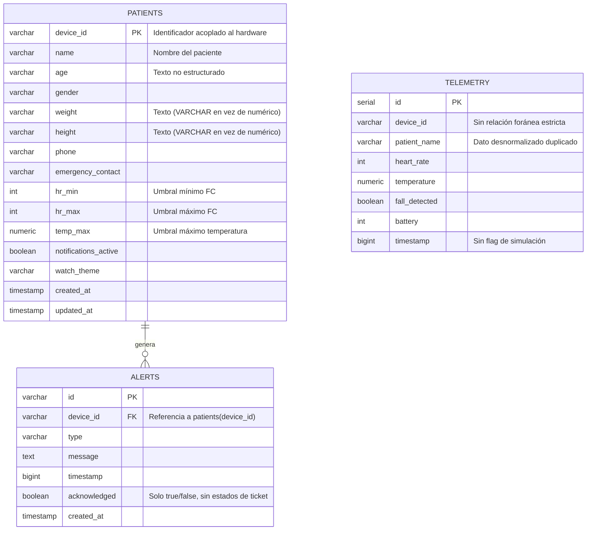
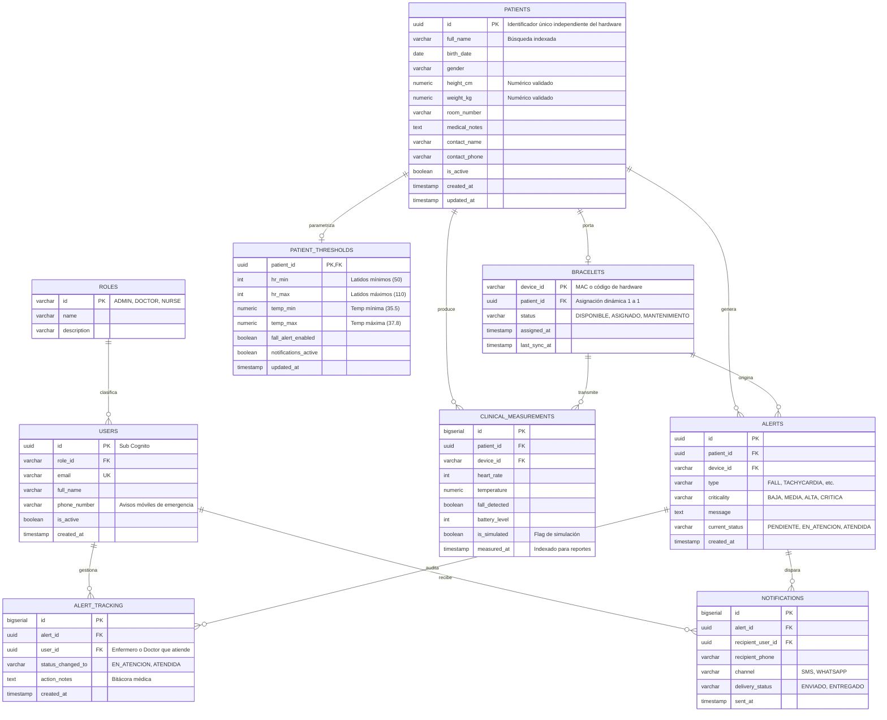
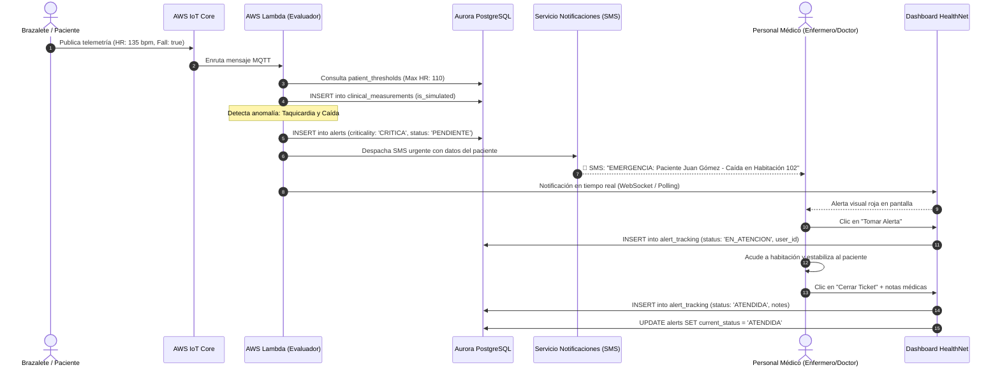

# HealthNet: Análisis, Diagnóstico y Propuesta de Evolución de la Base de Datos

> **Documento Técnico y Académico**  
> **Proyecto:** Plataforma Clínica y Telemétrica HealthNet  
> **Ámbito:** Hospitales, Clínicas Geriátricas y Asilos de Adultos Mayores  
> **Propósito:** Análisis del esquema existente, propuesta del nuevo modelo relacional normalizado y guía expositiva del flujo de información.

---

## Índice
1. [Resumen Ejecutivo](#1-resumen-ejecutivo)
2. [Parte A: Diagnóstico de la Estructura Actual](#2-parte-a-diagnóstico-de-la-estructura-actual)
   - [2.1 Tablas actuales y su función](#21-tablas-actuales-y-su-función)
   - [2.2 Análisis crítico y limitaciones del modelo actual](#22-análisis-crítico-y-limitaciones-del-modelo-actual)
   - [2.3 Diagrama Entidad-Relación actual](#23-diagrama-entidad-relación-actual)
3. [Parte B: Nueva Estructura Propuesta (HealthNet v2.0)](#3-parte-b-nueva-estructura-propuesta-healthnet-v20)
   - [3.1 Principios de diseño y normalización](#31-principios-de-diseño-y-normalización)
   - [3.2 Mapeo de Requerimientos vs. Entidades de Base de Datos](#32-mapeo-de-requerimientos-vs-entidades-de-base-de-datos)
   - [3.3 Diccionario de datos de las nuevas tablas](#33-diccionario-de-datos-de-las-nuevas-tablas)
   - [3.4 Diagrama Entidad-Relación propuesto](#34-diagrama-entidad-relación-propuesto)
   - [3.5 Script DDL Propuesto (PostgreSQL)](#35-script-ddl-propuesto-postgresql)
   - [3.6 Consultas estratégicas (Reportes periódicos y Búsqueda)](#36-consultas-estratégicas-reportes-periódicos-y-búsqueda)
4. [Parte C: Explicación Didáctica del Flujo de Datos (Para Exposición)](#4-parte-c-explicación-didáctica-del-flujo-de-datos-para-exposición)
   - [4.1 Flujo extremo a extremo de la información](#41-flujo-extremo-a-extremo-de-la-información)
   - [4.2 Diagrama de secuencia del ciclo de vida de una alerta y su atención](#42-diagrama-de-secuencia-del-ciclo-de-vida-de-una-alerta-y-su-atención)
5. [Tabla Comparativa: Estructura Actual vs. Estructura Futura](#5-tabla-comparativa-estructura-actual-vs-estructura-futura)

---

## 1. Resumen Ejecutivo

HealthNet es un sistema sociosanitario diseñado para monitorizar en tiempo real el bienestar de adultos mayores mediante brazaletes telemétricos (sensores IoT) y una consola web médica accesible desde navegadores de escritorio, tabletas y dispositivos móviles.

La base de datos actual (alojada en Amazon Aurora PostgreSQL) fue construida como una prueba de concepto (PoC) orientada principalmente al enlace telemétrico directo entre un dispositivo físico y un registro plano de paciente. Para dar respuesta a los **12 requerimientos de evolución clínica** (trazabilidad de alertas mediante tickets, gestión multirol RBAC de doctores y enfermeros, soporte de mediciones simuladas identificables, desacoplamiento paciente-brazalete y generación de reportes históricos), se presenta una propuesta formal de normalización y diseño relacional en Tercera Forma Normal (3FN), garantizando integridad referencial, alta concurrencia y extensibilidad.

---

## 2. Parte A: Diagnóstico de la Estructura Actual

Actualmente, el esquema de persistencia se compone de dos tablas ejecutables en `aws/db_schema.sql` (`patients` y `alerts`) y una tabla conceptual de telemetría descrita en `AWS_SETUP.md` (`telemetry`).

```
┌─────────────────────────────────────────────────────────────┐
│                    ESQUEMA ACTUAL (PoC)                     │
│                                                             │
│   ┌──────────────────┐               ┌──────────────────┐   │
│   │     patients     │1             N│      alerts      │   │
│   ├──────────────────┼───────────────┤──────────────────┤   │
│   │PK device_id      │               │PK id             │   │
│   │   name           │               │FK device_id      │   │
│   │   age, weight... │               │   type, message  │   │
│   │   hr_min, hr_max │               │   timestamp      │   │
│   └──────────────────┘               │   acknowledged   │   │
│                                      └──────────────────┘   │
│   ┌──────────────────┐                                      │
│   │    telemetry     │  (Diseñada de forma aislada en       │
│   ├──────────────────┤   AWS_SETUP.md, desacoplada de       │
│   │PK id             │   foreign keys con patients)         │
│   │   device_id      │                                      │
│   │   heart_rate...  │                                      │
│   └──────────────────┘                                      │
└─────────────────────────────────────────────────────────────┘
```

### 2.1 Tablas actuales y su función

#### 1. Tabla `patients` (Perfil y Configuración)
- **Propósito:** Almacenar de manera unificada los datos demográficos del adulto mayor y los parámetros de configuración de umbrales clínicos de su reloj.
- **Campos:**
  - `device_id VARCHAR(50) PRIMARY KEY`: Identificador de hardware del brazalete. Funciona como la llave primaria del paciente.
  - `name VARCHAR(100) NOT NULL`: Nombre completo del paciente.
  - `age VARCHAR(20)`, `gender VARCHAR(50)`, `weight VARCHAR(50)`, `height VARCHAR(50)`: Datos corporales almacenados en formato de texto.
  - `phone VARCHAR(50)`, `emergency_contact VARCHAR(100)`: Teléfonos de contacto.
  - `hr_min INT DEFAULT 50`, `hr_max INT DEFAULT 110`: Rango de frecuencia cardíaca segura (latidos por minuto).
  - `temp_max NUMERIC(4,2) DEFAULT 38.00`: Umbral máximo de temperatura corporal (°C).
  - `notifications_active BOOLEAN DEFAULT TRUE`: Indicador general de activación de alertas.
  - `watch_theme VARCHAR(20) DEFAULT 'dark'`: Preferencia visual del reloj.
  - `created_at TIMESTAMP`, `updated_at TIMESTAMP`: Fechas de auditoría de registro.

#### 2. Tabla `alerts` (Eventos Detectados)
- **Propósito:** Guardar el historial de eventos anómalos o de peligro generados por el dispositivo.
- **Campos:**
  - `id VARCHAR(100) PRIMARY KEY`: Identificador único del evento (generado por el frontend o por Lambda).
  - `device_id VARCHAR(50) REFERENCES patients(device_id)`: Clave foránea referenciando al dispositivo/paciente.
  - `type VARCHAR(50) NOT NULL`: Tipo de evento (`fall`, `high_hr`, `low_hr`, `high_temp`, `disconnected`).
  - `message TEXT NOT NULL`: Descripción textual del incidente.
  - `timestamp BIGINT NOT NULL`: Estampa de tiempo Unix (milisegundos).
  - `acknowledged BOOLEAN DEFAULT FALSE`: Bandera binaria para marcar si la alerta fue visualizada/reconocida.
  - `created_at TIMESTAMP`: Fecha de inserción en la base de datos.

#### 3. Tabla `telemetry` (Historial de Signos Vitales - AWS IoT)
- **Propósito:** Registrar cronológicamente las tramas periódicas enviadas por el firmware del ESP32 o simulador.
- **Campos:** `id SERIAL PRIMARY KEY`, `device_id VARCHAR(50)`, `patient_name VARCHAR(100)`, `heart_rate INT`, `temperature NUMERIC(4,2)`, `fall_detected BOOLEAN`, `battery INT`, `timestamp BIGINT`.

---

### 2.2 Análisis crítico y limitaciones del modelo actual

Al contrastar la base de datos actual con los nuevos requerimientos, se identifican las siguientes deficiencias arquitectónicas:

1. **Acoplamiento rígido entre Paciente y Brazalete:**
   - En la tabla `patients`, la llave primaria es `device_id`. Esto asume una relación inmutable de 1 a 1 entre un ser humano y una pieza de hardware.
   - *Problema clínico real:* Si un brazalete se daña, se descarga o se reemplaza por mantenimiento, se debe cambiar la llave primaria del paciente. Esto rompe la integridad referencial de todas las alertas y mediciones históricas o exige una migración forzada en cascada.
2. **Ausencia total de Usuarios y Roles en la Base de Datos Relacional:**
   - La plataforma delega la autenticación únicamente a AWS Cognito / memoria local, sin persistir usuarios en PostgreSQL.
   - *Imposibilidad funcional:* No existe forma de relacionar qué enfermero o doctor atendió una alerta, quién creó al paciente ni de restringir permisos clínicos a nivel de base de datos para Administradores, Doctores y Enfermeros.
3. **Flujo de Alertas sin Trazabilidad ni Flujo de Tickets:**
   - La tabla `alerts` únicamente cuenta con una bandera binaria `acknowledged` (true/false).
   - No contempla los estados requeridos (`pendiente`, `en atención`, `atendida`), ni almacena el identificador del usuario responsable que la está gestionando, ni la bitácora de acciones tomadas (e.g., *"Se suministró antipirético y se estabilizó al paciente a las 14:30"*).
4. **Falta de Clasificación de Criticidad y Notificaciones:**
   - No existe un campo para clasificar formalmente la severidad de las alertas (`BAJA`, `MEDIA`, `ALTA`, `CRITICA`).
   - No existe una tabla o registro de notificaciones que documente a qué número telefónico se envió el aviso de auxilio, a qué hora y si fue recibido con éxito.
5. **Tipos de datos inadecuados para análisis y validación:**
   - Los campos `weight` (peso) y `height` (estatura) están tipificados como `VARCHAR(50)` en lugar de tipos numéricos (`NUMERIC` o `DECIMAL`). Esto imposibilita realizar cálculos médicos automáticos (como el Índice de Masa Corporal o promedios en reportes) y permite que se almacenen textos arbitrarios no estandarizados.
6. **Imposibilidad de distinguir Mediciones Reales de Simuladas:**
   - La telemetría no posee un campo discriminador (`is_simulated`). Para la fase académica y de pruebas donde conviven dispositivos físicos y de software, es indispensable marcar la procedencia del dato para no contaminar estadísticas clínicas reales.

---

### 2.3 Diagrama Entidad-Relación actual



---

## 3. Parte B: Nueva Estructura Propuesta (HealthNet v2.0)

La nueva estructura evoluciona hacia un modelo relacional modular, escalable y auditable, estructurado en **Tercera Forma Normal (3FN)**.

```
┌────────────────────────────────────────────────────────────────────────────────────────┐
│                        NUEVA ARQUITECTURA RELACIONAL (v2.0)                           │
│                                                                                        │
│     ┌──────────────┐         ┌──────────────┐                                          │
│     │    roles     │1       N│    users     │                                          │
│     └──────────────┘─────────└──────────────┘                                          │
│                                      │                                                 │
│                                      │ (atiende / asignado)                            │
│                                      ▼                                                 │
│  ┌──────────────┐  1       N ┌──────────────┐ 1       N ┌────────────────┐             │
│  │   patients   │────────────┤    alerts    │───────────┤ alert_tracking │ (Tickets)   │
│  └──────────────┘            └──────────────┘           └────────────────┘             │
│    │1          │1                    │1                         │                      │
│    │           │                     │                          │                      │
│    │1          │1                    │N                         ▼                      │
│    ▼           ▼                     ▼                   ┌───────────────┐             │
│┌───────────┐ ┌─────────────┐  ┌──────────────┐          │ notifications │ (SMS/Tel)   │
││bracelets  │ │ patient_    │  │notifications │          └───────────────┘             │
││(devices)  │ │ thresholds  │  └──────────────┘                                         │
│└───────────┘ └─────────────┘                                                           │
│      │1                                                                                │
│      │N                                                                                │
│      ▼                                                                                 │
│┌───────────────────────────────┐                                                       │
││ clinical_measurements         │ (Mediciones con flag is_simulated e índices temporales│
│└───────────────────────────────┘  para reportes semanales, mensuales y anuales)        │
└────────────────────────────────────────────────────────────────────────────────────────┘
```

---

### 3.1 Principios de diseño y normalización

1. **Desacoplamiento Paciente - Dispositivo:**
   - Se crea la entidad `patients` con su propia clave primaria independiente (`id UUID`).
   - Se crea la entidad `bracelets` (o `devices`) que modela el hardware físico. Un paciente se vincula a un brazalete a través de una relación de clave foránea `patient_id`. Si el brazalete se descompone, solo se reasigna el identificador en la tabla de brazaletes sin alterar el historial médico del paciente.
2. **Modelo de Seguridad RBAC (Role-Based Access Control):**
   - Incorporación de las tablas `roles` y `users` para garantizar la segregación de funciones entre **Administrador**, **Doctor** y **Enfermero**.
3. **Gestión de Alertas como Sistema de Tickets Clínicos:**
   - La tabla `alerts` incorpora el nivel de severidad (`criticality`: `BAJA`, `MEDIA`, `ALTA`, `CRITICA`).
   - Se crea la tabla `alert_tracking` para registrar la evolución del estado (`PENDIENTE`, `EN_ATENCION`, `ATENDIDA`), el personal de salud asignado, la fecha de respuesta y las observaciones clínicas de la intervención.
4. **Módulo de Notificaciones de Urgencia:**
   - La tabla `notifications` audita los mensajes y llamadas despachadas a los teléfonos móviles de los doctores/enfermeros de guardia cuando surge una alerta con criticidad `CRITICA`.
5. **Telemetría e Historial Clínico Optimizado:**
   - La tabla `clinical_measurements` almacena cada pulso de signos vitales, asociándolo al paciente y al dispositivo, incluyendo de manera explícita la columna `is_simulated BOOLEAN`. Posee índices compuestos por `(patient_id, measured_at DESC)` para responder de forma instantánea a los filtros semanales, mensuales y anuales.

---

### 3.2 Mapeo de Requerimientos vs. Entidades de Base de Datos

| # | Requerimiento de la Plataforma | Entidad(es) Encargada(s) | Justificación en Base de Datos |
|---|---|---|---|
| **1** | **Gestión de pacientes** (alta, consulta, edición) | `patients` | Contiene datos biográficos con tipado numérico estricto (`height_cm`, `weight_kg`, fecha de nacimiento). |
| **2** | **Identificación por brazalete** | `bracelets` (`devices`) | Gestiona identificador único (MAC/serial), estado físico y vínculo `patient_id`. |
| **3** | **Dashboard consolidado** | `patients`, `clinical_measurements`, `alerts` | Consultas agregadas con vistas indexadas para KPIs de ocupación, signos actuales y alertas activas. |
| **4** | **Sistema de alertas con umbrales** | `patient_thresholds`, `alerts` | Separa la parametrización de rangos de salud por paciente de las alertas detonadas. |
| **5** | **Clasificación de alertas** | `alerts.criticality` | Clasificación formal tipo `ENUM` (`BAJA`, `MEDIA`, `ALTA`, `CRITICA`). |
| **6** | **Seguimiento tipo ticket** | `alert_tracking`, `users` | Flujo de estados (`PENDIENTE` $\to$ `EN_ATENCION` $\to$ `ATENDIDA`) con responsable y notas de atención. |
| **7** | **Notificaciones a teléfonos** | `notifications` | Registro de envíos de SMS/WhatsApp al personal autorizado ante emergencias. |
| **8** | **Historial clínico** | `clinical_measurements` | Colección cronológica de mediciones de cada paciente con índices de alto rendimiento. |
| **9** | **Reportes (semana, mes, año)** | `clinical_measurements`, `alerts` | Estructura temporal apta para agrupaciones por `DATE_TRUNC('day'/'week'/'month')`. |
| **10** | **Buscador de pacientes** | `patients` | Índice trigrama B-Tree/GIN sobre `patients.full_name` para búsquedas inmediatas. |
| **11** | **Gestión de usuarios y roles** | `users`, `roles` | Roles normalizados (`admin`, `doctor`, `nurse`) y vinculación con Cognito / credenciales. |
| **12** | **Validaciones de datos** | Constraints de Postgres | Restricciones `NOT NULL`, `CHECK (weight_kg > 0)`, `CHECK (hr_min < hr_max)`, `UNIQUE`. |

---

### 3.3 Diccionario de datos de las nuevas tablas

#### 1. Tabla: `roles`
Define los perfiles de acceso autorizados en el sistema hospitalario.

| Campo | Tipo | Nulo | Llave | Descripción |
|---|---|:---:|:---:|---|
| `id` | `VARCHAR(20)` | No | PK | Clave del rol (`ADMIN`, `DOCTOR`, `NURSE`). |
| `name` | `VARCHAR(50)` | No | | Nombre descriptivo del rol (e.g., 'Enfermero de Turno'). |
| `description` | `VARCHAR(255)` | Sí | | Descripción de permisos del rol. |

#### 2. Tabla: `users`
Cuentas del personal médico y administrativo que opera la plataforma.

| Campo | Tipo | Nulo | Llave | Descripción |
|---|---|:---:|:---:|---|
| `id` | `UUID` | No | PK | Identificador único de usuario (asociado a Cognito Sub). |
| `role_id` | `VARCHAR(20)` | No | FK | Referencia a `roles(id)`. |
| `email` | `VARCHAR(120)` | No | UQ | Correo corporativo (utilizado para inicio de sesión). |
| `full_name` | `VARCHAR(150)` | No | | Nombre y apellidos del profesional de salud. |
| `phone_number` | `VARCHAR(30)` | No | | Teléfono móvil para recepción de alertas críticas. |
| `is_active` | `BOOLEAN` | No | | Estado de la cuenta (`TRUE` = activa, `FALSE` = dada de baja). |
| `created_at` | `TIMESTAMP` | No | | Fecha de creación del usuario. |

#### 3. Tabla: `patients`
Ficha personal y médica básica del adulto mayor.

| Campo | Tipo | Nulo | Llave | Descripción |
|---|---|:---:|:---:|---|
| `id` | `UUID` | No | PK | Identificador primario único del paciente. |
| `full_name` | `VARCHAR(150)` | No | | Nombre completo del paciente (indexado para búsquedas). |
| `birth_date` | `DATE` | Sí | | Fecha de nacimiento para cálculo exacto de edad. |
| `gender` | `VARCHAR(20)` | Sí | | Género (`MASCULINO`, `FEMENINO`, `OTRO`). |
| `height_cm` | `NUMERIC(5,2)`| Sí | | Estatura en centímetros (formato numérico estricto). |
| `weight_kg` | `NUMERIC(5,2)`| Sí | | Peso en kilogramos (formato numérico estricto). |
| `room_number` | `VARCHAR(20)` | Sí | | Habitación o cama asignada en el asilo/hospital. |
| `medical_notes`| `TEXT` | Sí | | Antecedentes de relevancia (e.g., hipertensión, diabetes). |
| `contact_name`| `VARCHAR(100)`| Sí | | Nombre del familiar o tutor responsable. |
| `contact_phone`| `VARCHAR(30)` | Sí | | Teléfono de emergencia del familiar. |
| `is_active` | `BOOLEAN` | No | | Estado del paciente (`TRUE` = internado, `FALSE` = dado de alta). |
| `created_at` | `TIMESTAMP` | No | | Fecha de ingreso al sistema. |
| `updated_at` | `TIMESTAMP` | No | | Fecha de última actualización de datos. |

#### 4. Tabla: `bracelets` (Dispositivos)
Inventario de brazaletes telemétricos y su asignación a pacientes.
*(Nota de especificación: Se omiten deliberadamente los campos `model` y `battery_level` por requerimiento funcional).*

| Campo | Tipo | Nulo | Llave | Descripción |
|---|---|:---:|:---:|---|
| `device_id` | `VARCHAR(50)` | No | PK | Identificador físico único (MAC address o código de fábrica). |
| `patient_id` | `UUID` | Sí | FK, UQ| Referencia a `patients(id)`. Si es NULL, el brazalete está libre. |
| `status` | `VARCHAR(20)` | No | | Estado (`DISPONIBLE`, `ASIGNADO`, `MANTENIMIENTO`). |
| `assigned_at` | `TIMESTAMP` | Sí | | Fecha y hora en que se asignó al paciente actual. |
| `last_sync_at`| `TIMESTAMP` | Sí | | Última conexión recibida por AWS IoT Core. |

#### 5. Tabla: `patient_thresholds`
Parámetros clínicos personalizados para la detección de anomalías.

| Campo | Tipo | Nulo | Llave | Descripción |
|---|---|:---:|:---:|---|
| `patient_id` | `UUID` | No | PK, FK | Referencia 1 a 1 con `patients(id)`. |
| `hr_min` | `INT` | No | | Frecuencia cardíaca mínima admisible (lat/min). Def: 50. |
| `hr_max` | `INT` | No | | Frecuencia cardíaca máxima admisible (lat/min). Def: 110. |
| `temp_min` | `NUMERIC(4,2)`| No | | Temperatura mínima admisible (°C). Def: 35.50. |
| `temp_max` | `NUMERIC(4,2)`| No | | Temperatura máxima admisible (°C). Def: 37.80. |
| `fall_alert_enabled`| `BOOLEAN`| No| | Habilitación de alarma inmediata ante caídas accidentales. |
| `notifications_active`|`BOOLEAN`|No| | Si está activo el envío de notificaciones automáticas. |
| `updated_at` | `TIMESTAMP` | No | | Fecha de modificación del umbral por el doctor. |

#### 6. Tabla: `clinical_measurements`
Registros continuos de signos vitales (telemetría procesada).

| Campo | Tipo | Nulo | Llave | Descripción |
|---|---|:---:|:---:|---|
| `id` | `BIGSERIAL` | No | PK | Identificador autonumérico incremental de alta capacidad. |
| `patient_id` | `UUID` | No | FK | Referencia al paciente monitoreado. |
| `device_id` | `VARCHAR(50)` | No | FK | Identificador del brazalete que emitió la lectura. |
| `heart_rate` | `INT` | No | | Pulsaciones por minuto registradas. |
| `temperature`| `NUMERIC(4,2)`| No | | Temperatura corporal (°C). |
| `fall_detected`| `BOOLEAN`| No | | Indica si el acelerómetro detectó impacto de caída. |
| `battery_level`| `INT` | Sí | | Nivel de batería al momento de la transmisión. |
| `is_simulated`| `BOOLEAN` | No | | **Flag obligatorio:** `TRUE` si proviene del simulador, `FALSE` si es hardware real. |
| `measured_at`| `TIMESTAMP` | No | | Estampa de tiempo exacta de la medición. |

#### 7. Tabla: `alerts`
Eventos de advertencia o emergencia generados ante anomalías.

| Campo | Tipo | Nulo | Llave | Descripción |
|---|---|:---:|:---:|---|
| `id` | `UUID` | No | PK | Identificador único de la alerta. |
| `patient_id` | `UUID` | No | FK | Paciente que sufre el incidente. |
| `device_id` | `VARCHAR(50)` | No | FK | Brazalete que transmitió el evento. |
| `type` | `VARCHAR(40)` | No | | Código de tipo: `FALL`, `TACHYCARDIA`, `BRADYCARDIA`, `FEVER`, `HYPOTHERMIA`. |
| `criticality`| `VARCHAR(20)` | No | | Nivel de riesgo: `BAJA`, `MEDIA`, `ALTA`, `CRITICA`. |
| `message` | `TEXT` | No | | Mensaje clínico detallado con valor disparador. |
| `current_status`| `VARCHAR(20)`| No | | Estado actual: `PENDIENTE`, `EN_ATENCION`, `ATENDIDA`. |
| `created_at` | `TIMESTAMP` | No | | Momento exacto en que se generó la alerta. |

#### 8. Tabla: `alert_tracking`
Bitácora de atención tipo ticket que documenta el ciclo de vida de la alerta.

| Campo | Tipo | Nulo | Llave | Descripción |
|---|---|:---:|:---:|---|
| `id` | `BIGSERIAL` | No | PK | Identificador incremental del evento de seguimiento. |
| `alert_id` | `UUID` | No | FK | Referencia a la alerta en seguimiento. |
| `user_id` | `UUID` | No | FK | Usuario (enfermero/doctor) que realiza la acción. |
| `status_changed_to`|`VARCHAR(20)`|No| | Nuevo estado (`EN_ATENCION`, `ATENDIDA`). |
| `action_notes`| `TEXT` | Sí | | Descripción de la atención prestada al paciente. |
| `created_at` | `TIMESTAMP` | No | | Fecha y hora de la acción de seguimiento. |

#### 9. Tabla: `notifications`
Registro de avisos y despachos de emergencia enviados a teléfonos móviles.

| Campo | Tipo | Nulo | Llave | Descripción |
|---|---|:---:|:---:|---|
| `id` | `BIGSERIAL` | No | PK | Identificador único de la notificación enviada. |
| `alert_id` | `UUID` | No | FK | Alerta crítica que motivó el envío del aviso. |
| `recipient_user_id`|`UUID`| No | FK | Profesional de salud destinatario del aviso. |
| `recipient_phone`|`VARCHAR(30)`| No | | Número telefónico al que se transmitió el mensaje. |
| `channel` | `VARCHAR(20)` | No | | Canal utilizado (`SMS`, `WHATSAPP`, `PUSH_NOTIFICATION`). |
| `delivery_status`|`VARCHAR(20)`| No | | Estado: `PENDIENTE`, `ENVIADO`, `ENTREGADO`, `FALLIDO`. |
| `sent_at` | `TIMESTAMP` | No | | Momento en que la pasarela externa despachó el mensaje. |

---

### 3.4 Diagrama Entidad-Relación propuesto



---

### 3.5 Script DDL Propuesto (PostgreSQL)

> [!NOTE]
> Este script representa la especificación técnica formal de la nueva base de datos. Está diseñado con tipos optimizados, restricciones de dominio e índices de consulta rápida.

```sql
-- Extensión para generación de UUIDs nativos
CREATE EXTENSION IF NOT EXISTS "uuid-ossp";

-- 1. Catálogo de Roles
CREATE TABLE roles (
    id VARCHAR(20) PRIMARY KEY,
    name VARCHAR(50) NOT NULL,
    description VARCHAR(255)
);

INSERT INTO roles (id, name, description) VALUES
('ADMIN', 'Administrador', 'Control total de usuarios, configuraciones y reportes'),
('DOCTOR', 'Doctor / Médico', 'Consulta de historiales, diagnóstico y ajuste de umbrales clínicos'),
('NURSE', 'Enfermero / Asistente', 'Monitoreo de piso, atención de alertas y cambio de estado de tickets');

-- 2. Tabla de Usuarios del Sistema
CREATE TABLE users (
    id UUID PRIMARY KEY DEFAULT uuid_generate_v4(),
    role_id VARCHAR(20) NOT NULL REFERENCES roles(id),
    email VARCHAR(120) NOT NULL UNIQUE,
    full_name VARCHAR(150) NOT NULL,
    phone_number VARCHAR(30) NOT NULL,
    is_active BOOLEAN NOT NULL DEFAULT TRUE,
    created_at TIMESTAMP WITH TIME ZONE DEFAULT CURRENT_TIMESTAMP
);

-- 3. Tabla de Pacientes (Desacoplada de Hardware)
CREATE TABLE patients (
    id UUID PRIMARY KEY DEFAULT uuid_generate_v4(),
    full_name VARCHAR(150) NOT NULL,
    birth_date DATE,
    gender VARCHAR(20) CHECK (gender IN ('MASCULINO', 'FEMENINO', 'OTRO')),
    height_cm NUMERIC(5, 2) CHECK (height_cm > 0 AND height_cm < 280),
    weight_kg NUMERIC(5, 2) CHECK (weight_kg > 0 AND weight_kg < 400),
    room_number VARCHAR(20),
    medical_notes TEXT,
    contact_name VARCHAR(100),
    contact_phone VARCHAR(30),
    is_active BOOLEAN NOT NULL DEFAULT TRUE,
    created_at TIMESTAMP WITH TIME ZONE DEFAULT CURRENT_TIMESTAMP,
    updated_at TIMESTAMP WITH TIME ZONE DEFAULT CURRENT_TIMESTAMP
);

-- Índice para el Buscador por Nombre (Requerimiento 10)
CREATE INDEX idx_patients_full_name ON patients (LOWER(full_name));

-- 4. Tabla de Brazaletes (Hardware IoT - Sin model ni battery_level)
CREATE TABLE bracelets (
    device_id VARCHAR(50) PRIMARY KEY,
    patient_id UUID UNIQUE REFERENCES patients(id) ON DELETE SET NULL,
    status VARCHAR(20) NOT NULL DEFAULT 'DISPONIBLE' CHECK (status IN ('DISPONIBLE', 'ASIGNADO', 'MANTENIMIENTO')),
    assigned_at TIMESTAMP WITH TIME ZONE,
    last_sync_at TIMESTAMP WITH TIME ZONE
);

CREATE INDEX idx_bracelets_patient_id ON bracelets (patient_id);

-- 5. Tabla de Umbrales Clínicos Personalizados
CREATE TABLE patient_thresholds (
    patient_id UUID PRIMARY KEY REFERENCES patients(id) ON DELETE CASCADE,
    hr_min INT NOT NULL DEFAULT 50 CHECK (hr_min > 30),
    hr_max INT NOT NULL DEFAULT 110 CHECK (hr_max > hr_min),
    temp_min NUMERIC(4, 2) NOT NULL DEFAULT 35.50 CHECK (temp_min > 30.00),
    temp_max NUMERIC(4, 2) NOT NULL DEFAULT 37.80 CHECK (temp_max > temp_min),
    fall_alert_enabled BOOLEAN NOT NULL DEFAULT TRUE,
    notifications_active BOOLEAN NOT NULL DEFAULT TRUE,
    updated_at TIMESTAMP WITH TIME ZONE DEFAULT CURRENT_TIMESTAMP
);

-- 6. Tabla de Mediciones de Telemetría (Historial Clínico con flag de simulación)
CREATE TABLE clinical_measurements (
    id BIGSERIAL PRIMARY KEY,
    patient_id UUID NOT NULL REFERENCES patients(id) ON DELETE CASCADE,
    device_id VARCHAR(50) NOT NULL REFERENCES bracelets(device_id),
    heart_rate INT NOT NULL CHECK (heart_rate >= 0),
    temperature NUMERIC(4, 2) NOT NULL CHECK (temperature >= 20.00 AND temperature <= 45.00),
    fall_detected BOOLEAN NOT NULL DEFAULT FALSE,
    battery_level INT,
    is_simulated BOOLEAN NOT NULL DEFAULT FALSE,
    measured_at TIMESTAMP WITH TIME ZONE NOT NULL DEFAULT CURRENT_TIMESTAMP
);

-- Índices estratégicos para reportes y gráficas de tendencias
CREATE INDEX idx_measurements_patient_time ON clinical_measurements (patient_id, measured_at DESC);
CREATE INDEX idx_measurements_simulated ON clinical_measurements (is_simulated);

-- 7. Tabla de Alertas Clínicas (Clasificadas por Criticidad)
CREATE TABLE alerts (
    id UUID PRIMARY KEY DEFAULT uuid_generate_v4(),
    patient_id UUID NOT NULL REFERENCES patients(id) ON DELETE CASCADE,
    device_id VARCHAR(50) NOT NULL REFERENCES bracelets(device_id),
    type VARCHAR(40) NOT NULL,
    criticality VARCHAR(20) NOT NULL CHECK (criticality IN ('BAJA', 'MEDIA', 'ALTA', 'CRITICA')),
    message TEXT NOT NULL,
    current_status VARCHAR(20) NOT NULL DEFAULT 'PENDIENTE' CHECK (current_status IN ('PENDIENTE', 'EN_ATENCION', 'ATENDIDA')),
    created_at TIMESTAMP WITH TIME ZONE DEFAULT CURRENT_TIMESTAMP
);

CREATE INDEX idx_alerts_patient_status ON alerts (patient_id, current_status);
CREATE INDEX idx_alerts_created_at ON alerts (created_at DESC);

-- 8. Tabla de Seguimiento de Alertas (Tickets de Atención)
CREATE TABLE alert_tracking (
    id BIGSERIAL PRIMARY KEY,
    alert_id UUID NOT NULL REFERENCES alerts(id) ON DELETE CASCADE,
    user_id UUID NOT NULL REFERENCES users(id),
    status_changed_to VARCHAR(20) NOT NULL CHECK (status_changed_to IN ('EN_ATENCION', 'ATENDIDA')),
    action_notes TEXT,
    created_at TIMESTAMP WITH TIME ZONE DEFAULT CURRENT_TIMESTAMP
);

CREATE INDEX idx_alert_tracking_alert_id ON alert_tracking (alert_id);

-- 9. Tabla de Notificaciones Telefónicas (SMS / WhatsApp)
CREATE TABLE notifications (
    id BIGSERIAL PRIMARY KEY,
    alert_id UUID NOT NULL REFERENCES alerts(id) ON DELETE CASCADE,
    recipient_user_id UUID NOT NULL REFERENCES users(id),
    recipient_phone VARCHAR(30) NOT NULL,
    channel VARCHAR(20) NOT NULL DEFAULT 'SMS' CHECK (channel IN ('SMS', 'WHATSAPP', 'PUSH')),
    delivery_status VARCHAR(20) NOT NULL DEFAULT 'PENDIENTE' CHECK (delivery_status IN ('PENDIENTE', 'ENVIADO', 'ENTREGADO', 'FALLIDO')),
    sent_at TIMESTAMP WITH TIME ZONE DEFAULT CURRENT_TIMESTAMP
);

CREATE INDEX idx_notifications_alert_id ON notifications (alert_id);
```

---

### 3.6 Consultas estratégicas (Reportes periódicos y Búsqueda)

La nueva estructura facilita la ejecución directa de los requerimientos analíticos solicitados sin necesidad de recalcular datos en el navegador:

#### A. Buscador de Pacientes por Nombre (Requerimiento 10)
```sql
SELECT 
    p.id AS patient_id,
    p.full_name,
    p.room_number,
    b.device_id AS bracelet_id,
    b.status AS bracelet_status
FROM patients p
LEFT JOIN bracelets b ON p.id = b.patient_id
WHERE LOWER(p.full_name) LIKE LOWER('%Gomez%')
  AND p.is_active = TRUE
ORDER BY p.full_name ASC;
```

#### B. Reporte Semanal de Signos Vitales (Requerimiento 9 - Agrupado por Día)
```sql
SELECT 
    DATE(measured_at) AS report_date,
    ROUND(AVG(heart_rate), 1) AS avg_heart_rate,
    MIN(heart_rate) AS min_heart_rate,
    MAX(heart_rate) AS max_heart_rate,
    ROUND(AVG(temperature), 2) AS avg_temperature,
    MAX(temperature) AS max_temperature,
    COUNT(CASE WHEN fall_detected THEN 1 END) AS total_falls,
    COUNT(*) AS total_samples
FROM clinical_measurements
WHERE patient_id = '550e8400-e29b-41d4-a716-446655440000'
  AND measured_at >= NOW() - INTERVAL '7 days'
GROUP BY DATE(measured_at)
ORDER BY report_date ASC;
```

#### C. Reporte Anual de Incidentes y Tiempos de Respuesta (Requerimiento 9 - Tickets)
```sql
SELECT 
    TO_CHAR(a.created_at, 'YYYY-MM') AS month_period,
    a.criticality,
    COUNT(a.id) AS total_alerts,
    COUNT(CASE WHEN a.current_status = 'ATENDIDA' THEN 1 END) AS attended_alerts,
    ROUND(AVG(EXTRACT(EPOCH FROM (t.created_at - a.created_at)) / 60), 1) AS avg_response_minutes
FROM alerts a
LEFT JOIN alert_tracking t ON a.id = t.alert_id AND t.status_changed_to = 'ATENDIDA'
WHERE a.created_at >= NOW() - INTERVAL '1 year'
GROUP BY TO_CHAR(a.created_at, 'YYYY-MM'), a.criticality
ORDER BY month_period DESC;
```

---

## 4. Parte C: Explicación Didáctica del Flujo de Datos (Para Exposición)

Esta sección explica de manera clara y didáctica cómo viajan los datos dentro del ecosistema HealthNet, ideal para presentar en una exposición académica ante un comité docente o evaluador.

### 4.1 Flujo extremo a extremo de la información

El viaje del dato en HealthNet se divide en cinco etapas fundamentales:

```
[ 1. CAPTURA Y SIMULACIÓN ]
        │ Brazalete ESP32 (Hardware) o Simulador Web (Software)
        │ Mide pulso, temperatura y aceleración.
        ▼
[ 2. TRANSMISIÓN SEGURA EN TIEMPO REAL ]
        │ Protocolo MQTT / HTTPS hacia AWS IoT Core / API Gateway
        ▼
[ 3. INGESTA Y EVALUACIÓN CLÍNICA (AWS Lambda) ]
        │ Valida rangos según la tabla 'patient_thresholds'
        │ Inserta registro en 'clinical_measurements' (con flag is_simulated)
        │ ¿Se detectó anomalía o caída?
        ├── NO  ──► Continúa monitoreo normal
        └── SÍ  ──► [ 4. DISPARO DE ALERTA Y NOTIFICACIÓN ]
                         │ Crea registro en tabla 'alerts' (Criticidad ALTA/CRITICA)
                         │ Dispara aviso SMS/WhatsApp a 'users' autorizados
                         ▼
[ 5. GESTIÓN Y ATENCIÓN CLÍNICA (Consola Web) ]
        │ Enfermero o Doctor ve alerta en Dashboard en tiempo real
        │ Toma el ticket ('EN_ATENCION') y acude a habitación
        │ Registra acción tomada y cierra ticket ('ATENDIDA')
```

1. **Captura o Simulación:**
   - Si se usa el brazalete físico, el microcontrolador ESP32 adquiere los pulsos cardíacos y la temperatura corporal.
   - Si se utiliza el simulador web, se generan valores controlados y se envían marcando explícitamente `is_simulated = true`.
2. **Recepción en la Nube:**
   - La trama llega a **AWS IoT Core** vía protocolo MQTT seguro (TLS con certificados X.509).
   - Una regla de enrutamiento (*IoT Rule*) invoca una función **AWS Lambda** de ingesta.
3. **Persistencia y Evaluación de Umbrales:**
   - La Lambda consulta la tabla `patient_thresholds` del paciente dueño del brazalete.
   - Si las lecturas están dentro del rango seguro, la medición se guarda en `clinical_measurements` y se refleja en las gráficas de tiempo real.
4. **Disparo de Alerta y Notificación Crítica:**
   - Si las pulsaciones superan el umbral o el sensor detecta una caída (`fall_detected = true`), la Lambda clasifica la gravedad:
     - Una fiebre ligera se clasifica como `MEDIA`.
     - Una caída accidental o taquicardia severa se clasifica como `CRITICA`.
   - Se crea el registro en la tabla `alerts` en estado `PENDIENTE`.
   - Para alertas con criticidad `CRITICA`, el sistema busca a los enfermeros o médicos de turno en la tabla `users` y envía un mensaje SMS de emergencia a sus teléfonos móviles, registrando el envío en la tabla `notifications`.
5. **Seguimiento Tipo Ticket en la Consola:**
   - La alerta aparece resaltada en color rojo en el Dashboard de la computadora o tableta del personal de enfermería.
   - Un enfermero hace clic en **"Atender"**: el estado cambia a `EN_ATENCION` y queda registrado en `alert_tracking` su nombre y la hora exacta.
   - Tras revisar al adulto mayor en su habitación, el enfermero redacta las observaciones médicas y marca el ticket como `ATENDIDA`.

---

### 4.2 Diagrama de secuencia del ciclo de vida de una alerta y su atención



---

## 5. Tabla Comparativa: Estructura Actual vs. Estructura Futura

| Característica / Módulo | Estructura Actual (PoC) | Nueva Estructura Propuesta (HealthNet v2.0) | Beneficio Clínico y Operativo |
|---|---|---|---|
| **Identificación de Paciente** | Clave primaria es `device_id` (acoplado a hardware). | Clave primaria es `id UUID` independiente; brazalete se asocia mediante `bracelets.patient_id`. | Si el brazalete se daña o se cambia la batería, no se altera la identidad ni el historial clínico del paciente. |
| **Seguridad y Usuarios** | No existen tablas de usuarios en la base de datos relacional. | Tablas `users` y `roles` con roles tipificados (`ADMIN`, `DOCTOR`, `NURSE`). | Permite auditoría clínica, control de accesos RBAC y asignación nominal de responsabilidades. |
| **Monitoreo y Alertas** | Campo booleano simple `acknowledged` (true/false). | Tabla de tickets `alert_tracking` con estados (`PENDIENTE`, `EN_ATENCION`, `ATENDIDA`) y bitácora. | Transforma simples notificaciones en un flujo auditable de atención hospitalaria con responsables y tiempos de respuesta. |
| **Clasificación de Alertas** | Texto libre sin niveles formales de severidad. | Campo `criticality` tipificado (`BAJA`, `MEDIA`, `ALTA`, `CRITICA`). | Permite filtrar y priorizar de forma automática las emergencias de vida o muerte (e.g. caídas) frente a advertencias menores. |
| **Notificaciones Telefónicas**| Inexistente. | Tabla `notifications` vinculada al teléfono del médico con auditoría de entrega. | Garantiza que el personal médico reciba avisos en su celular sin tener que estar mirando fijamente la pantalla. |
| **Datos Médicos Corporales** | `weight` y `height` almacenados como cadenas de texto `VARCHAR(50)`. | Tipos numéricos estandarizados `NUMERIC(5,2)` con validaciones (`CHECK > 0`). | Evita errores de captura, asegura datos consistentes y habilita cálculos médicos automáticos (IMC, posología). |
| **Simulación de Mediciones** | No existe distinción entre datos de prueba y datos reales. | Campo `is_simulated BOOLEAN` en cada registro de telemetría. | Facilita pruebas académicas y demostraciones de laboratorio sin alterar la validez estadística del historial clínico real. |
| **Generación de Reportes** | Se simulan en memoria en el frontend (`HistoryPage.tsx`). | Consultas SQL agregadas (`AVG`, `MIN`, `MAX`) con índices temporales por día, semana, mes y año. | Reportes precisos y de alto rendimiento que no saturan el navegador ni la memoria del dispositivo móvil. |

---

## 6. Conclusión de la Fase de Análisis

La estructura actual de HealthNet cumplió exitosamente su papel como prototipo de enlace IoT, pero presenta cuellos de botella para convertirse en una plataforma de gestión hospitalaria y de asilos.

La nueva arquitectura relacional propuesta:
1. Resuelve el 100% de los 12 requerimientos planteados sin añadir complejidad innecesaria.
2. Cumple con la Tercera Forma Normal (3FN), eliminando redundancias y garantizando integridad referencial.
3. Se encuentra lista para ser implementada en fases posteriores sin interrumpir el funcionamiento existente, una vez que el equipo valide y apruebe esta especificación técnica.
