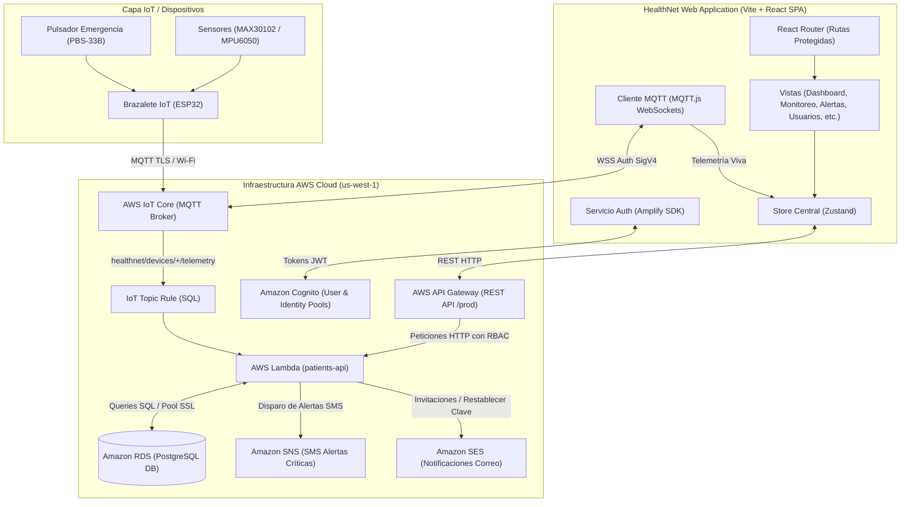
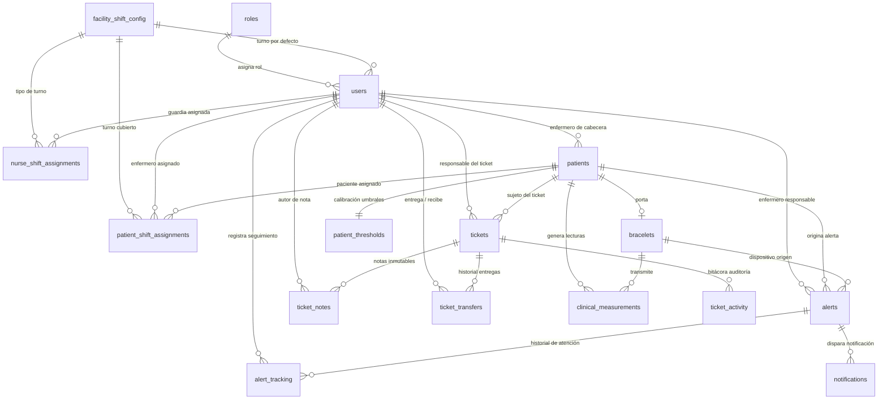

# DOCUMENTACIÓN TÉCNICA DEL SISTEMA HEALTHNET
**Plataforma Integral de Monitoreo Clínico Continuo y Telemetría IoT para Adultos Mayores**  
*Versión del Documento: 1.0.0*  
*Fecha de Emisión: Noviembre 2026*  
*Entorno Analizado: Frontend SPA (React + TypeScript) / Backend Serverless (AWS Lambda + PostgreSQL RDS / AWS IoT Core)*  

---

## ÍNDICE DE CONTENIDOS
1. [Descripción General](#1-descripción-general)
2. [Tecnologías Utilizadas](#2-tecnologías-utilizadas)
3. [Arquitectura y Estructura del Proyecto](#3-arquitectura-y-estructura-del-proyecto)
4. [Módulos Desarrollados y Control de Acceso (RBAC)](#4-módulos-desarrollados-y-control-de-acceso-rbac)
5. [Base de Datos Relacional](#5-base-de-datos-relacional)
6. [Seguridad Web y Control de Acceso](#6-seguridad-web-y-control-de-acceso)
7. [Integración con Servicios de AWS](#7-integración-con-servicios-de-aws)
8. [Ejecución, Pruebas y Mantenimiento](#8-ejecución-pruebas-y-mantenimiento)
9. [Estado Actual de Implementación: Implementado vs. Pendiente](#9-estado-actual-de-implementación-implementado-vs-pendiente)

---

## 1. DESCRIPCIÓN GENERAL

### 1.1. Propósito del Sistema
**HealthNet** es una plataforma tecnológica diseñada para la supervisión médica continua, telemetría fisiológica en tiempo real y gestión operativa de centros gerontológicos y asistenciales de estancia prolongada. Su propósito central es proteger la integridad de pacientes adultos mayores mediante la recepción y procesamiento de datos provenientes de dispositivos portátiles (brazaletes IoT basados en microcontroladores ESP32), facilitando una respuesta médica inmediata ante eventos de riesgo.

### 1.2. Objetivo Central
Automatizar la detección, canalización y resolución de incidentes clínicos (caídas, arritmias, hipotermia, hipertermia o pulsaciones de pánico) vinculando de manera estricta cada paciente con el personal de enfermería responsable según la fecha, el área física y el turno activo de guardia, garantizando una trazabilidad inmutable y auditable para la dirección médica.

### 1.3. Principales Características
* **Telemetría Fisiológica en Tiempo Real**: Recepción continua de frecuencia cardíaca (BPM), temperatura corporal (°C), detección de caídas y estado de batería vía MQTT sobre WebSockets con AWS IoT Core.
* **Sistema Integral de Tickets Clínicos con Folio Único**: Canalización formal de alertas médicas hacia tickets de trabajo con ciclo de vida estricto (*Recibido* $\rightarrow$ *En Progreso* $\rightarrow$ *Completado*), notas obligatorias de resolución y registro de entregas de turno.
* **Control de Acceso Basado en Roles (RBAC)**: Segregación multidimensional de responsabilidades asistenciales entre **Administrador**, **Doctor** y **Enfermero**.
* **Gestión de Turnos y Cobertura Territorial**: Matriz semanal de guardias (Matutino, Vespertino, Nocturno) con asignación de hasta 3 enfermeros por paciente (uno por cada turno) y algoritmos de prevención de colisiones horarias.
* **Paginación y Filtrado Multicriterio**: Navegación segmentada en bloques de 10, 30, 50 y 100 registros con preservación de filtros clínicos y reinicio contextual a la primera página.
* **Arquitectura de Resiliencia Híbrida**: Funcionamiento dual preparado para trabajar enlazado a la infraestructura AWS Cloud o en modo de contingencia local offline persistente en el navegador cliente.

---

## 2. TECNOLOGÍAS UTILIZADAS

### 2.1. Lenguajes y Ecosistema Base
* **TypeScript 5.5.3**: Tipado estático estricto en el frontend (`strict: true`), interfaces clínicas, enums de roles y tipos de datos fisiológicos.
* **JavaScript (Node.js 18.x / 20.x)**: Entorno de ejecución en AWS Lambda (CommonJS y ESModules) y scripts de automatización.
* **SQL (PostgreSQL Dialect)**: Definición de esquemas relacionales, triggers de actualización temporal, restricciones de integridad referencial y funciones PL/pgSQL.

### 2.2. Frontend (Single Page Application - SPA)
* **React 18.3.1**: Biblioteca fundamental para la construcción de interfaces declarativas basadas en componentes y hooks personalizados.
* **Vite 5.4.2**: Empaquetador y servidor de desarrollo ultra-rápido, configurado con división de código (*code splitting*) y compresión de fragmentos.
* **Tailwind CSS 3.4.14**: Framework de utilidades CSS para diseño responsivo adaptado a resoluciones estándar (1920×1080) y soporte nativo de modo claro y oscuro (`dark mode`).
* **React Router DOM 6.26.2**: Enrutador cliente SPA con soporte de rutas públicas, rutas protegidas mediante Higher-Order Components y lazy-loading con `React.Suspense`.

### 2.3. Manejo de Estado y Conectividad
* **Zustand 4.5.5**: Gestor de estado global reactivo ligero utilizado para almacenar dispositivos, telemetría, tickets, alertas, filtros de interfaz y preferencias de tema.
* **MQTT.js 5.10.1**: Cliente MQTT para navegador que establece conexiones persistentes bidireccionales con AWS IoT Core sobre WebSockets seguros (`wss://`).
* **AWS Amplify v6.8.0**: SDK oficial de AWS para gestión de autenticación federada con Amazon Cognito (User Pools e Identity Pools).

### 2.4. Visualización de Datos y Documentación Clínica
* **Recharts 2.12.7**: Librería de gráficos interactivos SVG para renderizar curvas de electrocardiograma (EKG simulado o real), tendencias de pulso y variación de temperatura.
* **Lucide React 0.383.0**: Colección de iconografía médica, operacional y de navegación.
* **Date-fns 3.6.0**: Manipulación y formateo de fechas y horas internacionales con localización en español (`es`).
* **jsPDF 4.2.1** & **html2canvas 1.4.1**: Generación del lado del cliente de informes clínicos individuales en formato PDF con diseño institucional.
* **DOMPurify 3.2.4**: Sanitización de entradas y cadenas HTML para mitigación de vulnerabilidades XSS.

### 2.5. Backend y Servicios Serverless
* **AWS Lambda**: Funciones sin servidor para procesamiento de la API REST (`patients-api`) y procesamiento de eventos IoT.
* **node-postgres (`pg` 8.11.3)**: Cliente PostgreSQL para Node.js con soporte de pool de conexiones y conexiones cifradas TLS/SSL.
* **Amazon RDS PostgreSQL (v13+)**: Motor de base de datos relacional para almacenamiento centralizado persistente.
* **AWS SDK v3**: Módulos cliente `@aws-sdk/client-sns` (despacho de SMS de emergencia) y `@aws-sdk/client-ses` (invitaciones y restablecimiento de credenciales).

### 2.6. Herramientas de Pruebas y Calidad de Código
* **Vitest 2.1.9**: Entorno de ejecución de pruebas unitarias automatizadas integrado con Vite.
* **PostCSS 8.4.38** & **Autoprefixer 10.4.20**: Preprocesamiento de estilos para compatibilidad entre navegadores (Google Chrome, Microsoft Edge, Mozilla Firefox, Safari).

---

## 3. ARQUITECTURA Y ESTRUCTURA DEL PROYECTO

### 3.1. Diagrama de Arquitectura de Alto Nivel
A continuación se detalla la interacción entre el hardware médico, los servicios de AWS y la interfaz web del usuario:



### 3.2. Estructura de Directorios del Código Fuente

```
HealthNet/
├── .env.example                               # Plantilla de variables de entorno de AWS
├── .gitignore                                 # Exclusiones de control de versiones
├── AUDITORIA_FUNCIONAL_GENERAL_HEALTHNET.md   # Reporte previo de auditoría clínica
├── DOCUMENTACION_TECNICA_HEALTHNET.md         # Documento técnico maestro del sistema
├── index.html                                 # Punto de entrada HTML del frontend
├── package.json                               # Dependencias, scripts y configuración de build
├── tailwind.config.js                         # Configuración de Tailwind CSS y paleta clínica
├── tsconfig.json                              # Configuración maestra de TypeScript
├── vite.config.ts                             # Configuración de compilación y optimización Vite
│
├── aws/                                       # Infraestructura y Backend Serverless
│   ├── cloudformation_healthnet_stack.yaml    # Plantilla IaC de CloudFormation
│   ├── deploy_all.ps1                         # Script automatizado de despliegue PowerShell
│   ├── deploy_all.sh                          # Script automatizado de despliegue Bash
│   ├── esp32_firmware.ino                     # Firmware C++ para microcontrolador ESP32
│   ├── healthnet_database_schema_master.sql   # Esquema SQL definitivo y consolidado (v9.0)
│   └── lambdas/
│       └── patients-api/                      # Función Lambda REST y webhook IoT
│           ├── index.js                       # Controlador principal y router de la API
│           ├── package.json                   # Dependencias de la Lambda (pg, etc.)
│           └── function_deploy.zip            # Paquete empaquetado para despliegue
│
└── src/                                       # Frontend de la Aplicación
    ├── App.tsx                                # Router principal, temas y rutas protegidas
    ├── main.tsx                               # Inicialización de la aplicación React
    ├── index.css                              # Estilos globales y directivas Tailwind
    │
    ├── assets/                                # Recursos estáticos y multimedia
    │
    ├── components/                            # Componentes de UI Reutilizables
    │   ├── ChangePasswordModal.tsx            # Modal de actualización de contraseña
    │   ├── DeviceCard.tsx                     # Tarjeta de paciente en Dashboard
    │   ├── DeviceReportTemplate.tsx           # Plantilla HTML oculta para exportación a PDF
    │   ├── Logo.tsx                           # Isotipo y logotipo vectorial HealthNet
    │   ├── LogoutConfirmModal.tsx             # Modal de confirmación para cerrar sesión
    │   ├── Navbar.tsx                         # Barra superior de navegación y alertas activas
    │   ├── ProtectedRoute.tsx                 # Guardián de rutas por rol de usuario
    │   ├── Sidebar.tsx                        # Barra lateral retráctil con menú RBAC
    │   ├── TablePagination.tsx                # Control transversal de paginación (10/30/50/100)
    │   └── charts/                            # Componentes de Gráficas Clínicas
    │       ├── HeartRateChart.tsx             # Curva de pulso cardíaco
    │       └── TempChart.tsx                  # Curva de temperatura corporal
    │
    ├── config/                                # Parámetros de Configuración
    │   └── aws.ts                             # Carga y validación de variables de entorno AWS
    │
    ├── hooks/                                 # Custom Hooks de React
    │   └── useAuth.ts                         # Contexto de autenticación, rol y credenciales
    │
    ├── pages/                                 # Vistas Principales de la Plataforma
    │   ├── AlertsPage.tsx                     # Gestión de Tickets Clínicos y Bitácora
    │   ├── DashboardPage.tsx                  # Tablero General según Rol (Admin/Médico)
    │   ├── LoginPage.tsx                      # Autenticación y acceso al sistema
    │   ├── MonitoringPage.tsx                 # Monitoreo en vivo, histórico y reportes PDF
    │   ├── ProfilePage.tsx                    # Expediente de Pacientes y Brazaletes IoT
    │   ├── SimulatorPage.tsx                  # Consola del Simulador IoT (Admin)
    │   └── UsersManagementPage.tsx            # Usuarios, Horarios y Matriz de Turnos
    │
    ├── services/                              # Capa de Servicios y Lógica de Negocio
    │   ├── auth.ts                            # Servicio de autenticación (Cognito/Local)
    │   ├── iot.ts                             # Cliente MQTT sobre WebSockets de AWS IoT
    │   ├── patientAssignmentService.ts        # Asignación territorial paciente-enfermero
    │   ├── patients.ts                        # Cliente HTTP para API REST de Pacientes
    │   ├── shiftService.ts                    # Gestión y validación de turnos semanales
    │   └── simulator.ts                       # Generador de telemetría de prueba local
    │
    ├── store/                                 # Gestión de Estado Global
    │   └── deviceStore.ts                     # Store Zustand (Telemetría, Alertas, Turnos)
    │
    ├── tests/                                 # Pruebas Unitarias Automatizadas
    │   ├── dataIntegrity.test.ts              # Pruebas de no-falsificación de telemetría
    │   ├── kpiCalculations.test.ts            # Pruebas de cálculo de indicadores médicos
    │   ├── phoneValidator.test.ts             # Pruebas de formato telefónico E.164
    │   └── shiftService.test.ts               # Pruebas de prevención de conflictos de turnos
    │
    ├── types/                                 # Modelos de Datos y Tipos TypeScript
    │   └── index.ts                           # Definiciones de roles, entidades y permisos
    │
    └── utils/                                 # Utilidades y Funciones Auxiliares
        ├── auditLogger.ts                     # Trazabilidad de acciones de usuario
        └── phoneValidator.ts                  # Normalizador y validador de formato E.164
```

---

## 4. MÓDULOS DESARROLLADOS Y CONTROL DE ACCESO (RBAC)

HealthNet implementa una matriz de **Control de Acceso Basado en Roles (RBAC)** que segrega las funciones administrativas de las responsabilidades asistenciales y diagnósticas.

### 4.1. Matriz Comparativa de Roles y Privilegios

| Funcionalidad / Operación | Administrador (`admin`) | Doctor (`doctor`) | Enfermero (`nurse`) |
| :--- | :---: | :---: | :---: |
| **Dashboard Estratégico (KPIs de Gestión / Personal)** | ✅ Sí | ❌ No | ❌ No |
| **Dashboard Clínico (Constantes Vitales de Pacientes)** | ❌ No | ✅ Sí | ✅ Sí |
| **Directorio de Monitoreo y Gráficas en Tiempo Real** | ✅ Sí | ✅ Sí | ✅ Sí |
| **Generación y Descarga de Reporte Clínico en PDF** | ❌ No | ✅ Sí | ❌ No |
| **Recepción de Alertas Clínicas y Bitácora** | ✅ Sí (Lectura) | ✅ Sí (Lectura) | ✅ Sí (Atención) |
| **Atención, Resolución y Notas en Tickets de Alertas** | ❌ Bloqueado | ❌ Bloqueado | ✅ Exclusivo |
| **Entrega / Transferencia Formal de Tickets entre Turnos** | ❌ Bloqueado | ❌ Bloqueado | ✅ Exclusivo |
| **Alta, Baja y Modificación de Datos Personales de Pacientes** | ✅ Exclusivo | ❌ Bloqueado | ❌ Bloqueado |
| **Actualización de Peso y Estatura de Pacientes** | ❌ Bloqueado | ❌ Bloqueado | ✅ Exclusivo |
| **Calibración de Umbrales Médicos de Alerta** | ❌ Bloqueado | ✅ Exclusivo | ❌ Bloqueado |
| **Archivado / Reactivación de Pacientes** | ✅ Exclusivo | ❌ Bloqueado | ❌ Bloqueado |
| **Vinculación / Desvinculación de Brazaletes IoT** | ✅ Exclusivo | ❌ Bloqueado | ❌ Bloqueado |
| **Gestión Integral de Usuarios (Crear / Suspender / Claves)** | ✅ Exclusivo | ❌ Bloqueado | ❌ Bloqueado |
| **Programación Semanal de Turnos del Personal** | ✅ Exclusivo | ❌ Bloqueado | ❌ Bloqueado |
| **Consulta de Turnos de Todo el Personal** | ✅ Sí | ✅ Sí | ❌ Solo el propio |
| **Asignación Territorial de Pacientes a Turnos** | ✅ Sí | ✅ Sí | ❌ Bloqueado |
| **Acceso al Simulador IoT (`/simulator`)** | ✅ Exclusivo | ❌ Prohibido (403) | ❌ Prohibido (403) |

---

### 4.2. Detalle de los Módulos del Sistema

#### Módulo 1: Autenticación, Sesión y Cierre de Sesión (`/login`)
* **Propósito**: Validar credenciales institucionales y establecer el contexto de seguridad del usuario.
* **Componentes**: `LoginPage.tsx`, `useAuth.ts`, `LogoutConfirmModal.tsx`.
* **Capacidades**:
  * Autenticación dual: Enlace con Amazon Cognito User Pools vía tokens JWT o credenciales preconfiguradas en modo demo offline.
  * Verificación obligatoria de estado de cuenta: Los usuarios con `isActive: false` tienen el acceso bloqueado de inmediato.
  * **Confirmación de Cierre de Sesión**: Intercepción obligatoria en barra lateral y cabecera; presenta un modal con advertencia explícita y opciones de *Cancelar* (mantiene la sesión intacta) y *Cerrar sesión* (limpia tokens y redirige al login).

#### Módulo 2: Dashboard Principal (`/dashboard`)
* **Propósito**: Proveer una visión general y centralizada del estado del centro médico.
* **Componentes**: `DashboardPage.tsx`, `DeviceCard.tsx`.
* **Capacidades**:
  * **Vista Administrador**: Enfocada en recursos humanos, distribución de enfermeros por turno, ocupación de camas, total de pacientes activos y cumplimiento de asignaciones.
  * **Vista Doctor / Enfermero**: Enfocada en pacientes críticos, alertas pendientes de atención médica, telemetría fisiológica agregada y accesos rápidos filtrados hacia la bitácora de tickets.
  * **Redirección Contextual con Filtrado Automático**: Al pulsar tarjetas de alertas o caídas, la plataforma redirige a la sección correspondiente preaplicando los filtros de estado y criticidad.

#### Módulo 3: Monitoreo Clínico (`/monitoring`)
* **Propósito**: Visualización continua de constantes vitales de los adultos mayores bajo supervisión.
* **Componentes**: `MonitoringPage.tsx`, `HeartRateChart.tsx`, `TempChart.tsx`, `TablePagination.tsx`.
* **Capacidades**:
  * Directorio tabular institucional con filtros cruzados: búsqueda por nombre/cama, filtro por género, piso y pacientes con alertas activas.
  * Paginación dinámica configurable en 10, 30, 50 o 100 registros.
  * Panel individual de constantes en vivo: gráfica EKG y curva térmica interactiva.
  * **Regla de Integridad de Datos (Regla de Oro)**: Si el dispositivo está asignado como hardware real en el sistema clínico y transmite telemetría, sus datos son leídos directamente de la base de datos / IoT Core sin sintetizar ni falsificar mediciones.
  * Generación y descarga directa en el navegador de informes clínicos individuales en formato PDF con membrete institucional.

#### Módulo 4: Gestión y Seguimiento de Tickets Clínicos (`/alerts`)
* **Propósito**: Trazabilidad completa de incidentes, emergencias médicas y asignación formal de responsabilidades.
* **Componentes**: `AlertsPage.tsx`, `TablePagination.tsx`.
* **Capacidades**:
  * Generación automática de Folio Único (`TCK-XXXXXXXX`) por cada alerta detectada.
  * Asignación automatizada al enfermero de turno según la programación semanal.
  * Sistema de Paginación: Selector de 10, 30, 50 o 100 registros por página, navegación `← Anterior | Página X de Y | Siguiente →`, y reinicio automático a página 1 al alterar cualquier filtro.
  * Panel de resolución clínica: Exige al enfermero documentar la acción realizada y las observaciones antes de marcar el ticket como *Completado*.
  * Transferencia de turno: Permite entregar formalmente un ticket no resuelto a un compañero del siguiente turno registrando el motivo en una bitácora inmutable.

#### Módulo 5: Pacientes y Brazaletes (`/profile`)
* **Propósito**: Administración de fichas de ingreso, datos somatométricos y vinculación de hardware.
* **Componentes**: `ProfilePage.tsx`.
* **Capacidades**:
  * Pestañas diferenciadas: *Pacientes Activos* y *Pacientes Archivados*.
  * **Principio de Preservación Histórica**: La opción de eliminación permanente de pacientes ha sido reemplazada por el *Archivado Clínico* (`is_archived: true`), manteniendo intacto el expediente histórico, caídas y mediciones previas.
  * Bloqueo de campos por rol: Los médicos solo pueden editar umbrales de alerta; los datos personales y de ubicación son de control administrativo.

#### Módulo 6: Gestión de Usuarios, Horarios y Turnos (`/users`)
* **Propósito**: Control de personal, programación semanal de guardias y asignación de camas.
* **Componentes**: `UsersManagementPage.tsx`, `shiftService.ts`, `patientAssignmentService.ts`.
* **Capacidades**:
  * Directorio de usuarios con paginación, búsqueda por teléfono/correo y estado de cuenta (*Activa* / *Suspendida*).
  * Suspensión administrativa: Desactiva el acceso de un usuario registrando fecha, administrador responsable y motivo.
  * Matriz semanal de turnos con detección preventiva de conflictos horarios.
  * Cobertura territorial: Asignación de hasta tres enfermeros por paciente (uno por cada turno: matutino, vespertino y nocturno).

#### Módulo 7: Simulador IoT (`/simulator`)
* **Propósito**: Consola de pruebas de emisión de paquetes MQTT para validación de arquitectura sin depender de hardware físico conectado.
* **Componentes**: `SimulatorPage.tsx`, `simulatorService.ts`.
* **Seguridad y Restricción**:
  * Acceso reservado **exclusivamente al Administrador**.
  * Oculto en las barras de navegación de doctores y enfermeros.
  * Bloqueado ante intentos de acceso por URL directa (redirección instantánea a `/dashboard`).
  * Validación en backend (AWS Lambda): Las solicitudes que interactúan con endpoints del simulador retornan **HTTP 403 Forbidden** si el usuario no tiene rol `admin`.

---

## 5. BASE DE DATOS RELACIONAL

El backend persistente de HealthNet está modelado sobre **PostgreSQL** (versión 13 o superior), desplegado en **Amazon RDS**. El esquema maestro consolidado e idempotente se encuentra alojado en `aws/healthnet_database_schema_master.sql`.

### 5.1. Diagrama Entidad-Relación (ERD)



### 5.2. Diccionario de Tablas Principales

#### 1. `roles` (Catálogo RBAC)
Almacena los perfiles autorizados en el sistema: `admin` (Administrador), `doctor` (Médico Geriatra) y `nurse` (Personal de Enfermería).

#### 2. `facility_shift_config` (Horarios Institucionales)
Define las tres ventanas temporales de atención:
* `matutino`: 07:00 a 15:00
* `vespertino`: 15:00 a 23:00
* `nocturno`: 23:00 a 07:00

#### 3. `users` (Personal Clínico y Administrativo)
Almacena las cuentas de usuario. Incluye columnas para suspensión administrativa: `is_active` (booleano), `suspended_at`, `suspended_by` y `suspended_reason`.

#### 4. `patients` (Expediente del Adulto Mayor)
Ficha clínica de los residentes. Incluye somatometría (`height_cm`, `weight_kg`), ubicación física (`room_number`, `floor`, `bed_number`), contacto de emergencia y las columnas de preservación histórica: `is_archived`, `archived_at`, `archived_by` y `archived_reason`.

#### 5. `bracelets` (Hardware IoT Desacoplado)
Registra los dispositivos físicos por su `device_id` (MAC o identificador único). Admite los estados: `DISPONIBLE`, `ASIGNADO`, `MANTENIMIENTO` y `NO_EN_USO`. La desvinculación de un paciente no elimina el brazalete ni sus lecturas históricas.

#### 6. `patient_thresholds` (Calibración de Alertas Médicas)
Almacena los rangos fisiológicos permitidos para cada paciente (`hr_min`, `hr_max`, `temp_min`, `temp_max`, `fall_alert_enabled`, `notifications_active`). Exclusivamente configurable por usuarios con rol de Doctor.

#### 7. `clinical_measurements` (Constantes Vitales y Telemetría)
Tabla de alto volumen indexada cronológicamente que almacena las lecturas transmitidas por los brazaletes: `heart_rate`, `temperature`, `fall_detected`, `emergency_pressed`, `battery_level` y marca de tiempo (`measured_at`).

#### 8. `nurse_shift_assignments` (Programación Semanal de Turnos)
Asigna a un enfermero un turno institucional durante una semana específica (`week_start_date`). Posee una restricción de unicidad `uq_nurse_week` para evitar empalmes en la misma semana.

#### 9. `patient_shift_assignments` (Asignación Territorial por Turno)
Relaciona a un paciente con un enfermero en un turno específico durante una semana. Cuenta con un índice único condicional que garantiza que un paciente tenga un único enfermero por cada turno, permitiendo hasta tres responsables al día (uno matutino, uno vespertino y uno nocturno).

#### 10. `alerts` y `alert_tracking`
Registra los eventos clínicos anómalos detectados, su criticidad (`baja`, `media`, `alta`, `critica`), su estado (`PENDIENTE`, `EN_ATENCION`, `ATENDIDA`) y el historial cronológico de seguimiento.

#### 11. `tickets`, `ticket_notes`, `ticket_transfers` y `ticket_activity`
Estructura de gestión de incidentes clínicos con folio formal:
* `tickets`: Cabecera del ticket con asignación, turno, criticidad y notas de resolución.
* `ticket_notes`: Notas acumulativas e inmutables redactadas por el personal asistencial.
* `ticket_transfers`: Registro inalterable de entregas de turno (enfermero emisor, receptor, turno y motivo).
* `ticket_activity`: Línea de tiempo de auditoría automática de cada acción ocurrida en el ticket.

#### 12. `audit_log` (Bitácora de Trazabilidad del Sistema)
Registro centralizado para auditoría informática y clínica: almacena usuario, correo, rol, acción ejecutada, entidad afectada y cambios en formato JSONB.

---

## 6. SEGURIDAD WEB Y CONTROL DE ACCESO

### 6.1. Autenticación y Manejo de Sesiones
1. **Tokens Criptográficos JWT**: En la integración con Amazon Cognito, el frontend almacena los tokens de acceso (*IdToken* y *AccessToken*) gestionados por la biblioteca de Amplify en almacenamiento seguro de sesión.
2. **Cierre de Sesión Obligatorio y Confirmado**: Todas las opciones de logout activan un modal de confirmación ([LogoutConfirmModal.tsx](file:///c:/Users/DELL/Desktop/leli/Uni/Huevo%20revuelto/Popochitos/HealthNet/src/components/LogoutConfirmModal.tsx)), impidiendo cierres accidentales y asegurando la invalidación total de las credenciales en memoria al confirmar.
3. **Control de Inactividad y Cuentas Suspendidas**: Antes de procesar cualquier acción en frontend o backend, se evalúa el campo `is_active`. Si la cuenta fue suspendida administrativamente, se rechaza la petición con código HTTP 403.

### 6.2. Autorización por Roles en Frontend
* **Guardián de Rutas (`ProtectedRoute.tsx`)**: Evalúa el rol del usuario autenticado contra la lista de roles permitidos (`allowedRoles`). Si el usuario carece de privilegios, es redirigido inmediatamente a `/dashboard`.
* **Renderizado Condicional de Interfaz**: Los botones de acción crítica (atención de alertas, edición de umbrales médicos, altas de pacientes o configuración de turnos) se ocultan o bloquean según la matriz `ROLE_PERMISSIONS` definida en `src/types/index.ts`.

### 6.3. Autorización y Validación Estricta en Backend (AWS Lambda)
La seguridad no depende únicamente del frontend. En la función Lambda `aws/lambdas/patients-api/index.js`, cada solicitud entrante es verificada:
* **Lectura de Cabeceras de Identidad**: Se extrae y valida el rol del invocador (`callerRole`) obtenido de los claims del autorizador Cognito o cabeceras normalizadas.
* **Prohibición de Privilegios por Defecto**: Si una petición carece de rol válido (`admin`, `doctor`, `nurse`), se rechaza con **HTTP 401 Unauthorized**.
* **Bloqueo del Simulador IoT para No-Administradores**: Cualquier petición HTTP dirigida a rutas `/simulator` ejecutada por doctores o enfermeros retorna inmediatamente **HTTP 403 Forbidden**.
* **Protección de Notas Clínicas y Resolución**: Solo el rol `nurse` puede registrar notas de atención y resolver tickets. Peticiones de resolución enviadas por doctores o administradores son denegadas.

### 6.4. Protección de Datos y Sanitización
* **Validación Telefónica E.164**: Todos los números telefónicos registrados se validan mediante expresiones regulares y se normalizan con el estándar internacional E.164 (`+52XXXXXXXXXX`) antes de persistirse o enviarse a AWS SNS ([phoneValidator.ts](file:///c:/Users/DELL/Desktop/leli/Uni/Huevo%20revuelto/Popochitos/HealthNet/src/utils/phoneValidator.ts)).
* **Consultas Parametrizadas**: Todas las consultas ejecutadas por la Lambda hacia PostgreSQL utilizan sentencias preparadas con parámetros posicionales (`$1, $2, ...`), eliminando riesgos de inyección SQL.

---

## 7. INTEGRACIÓN CON SERVICIOS DE AWS

| Servicio de AWS | Propósito en HealthNet | Estado Actual de Implementación |
| :--- | :--- | :--- |
| **AWS IoT Core** | Recepción de telemetría y alertas MQTT desde los brazaletes ESP32 sobre WebSockets (`wss://`). | **Implementado y Conectado en Código.** Soporta suscripción a tópicos `healthnet/devices/+/telemetry`. |
| **Amazon Cognito (User Pool)** | Directorio de identidades clínicas, autenticación federada y emisión de tokens JWT. | **Implementado en Código.** Cuenta con servicio de fallback local para entornos donde no se configuren las variables. |
| **Amazon Cognito (Identity Pool)** | Concesión de credenciales temporales de AWS (SigV4) para firmar la conexión WebSocket a IoT Core. | **Implementado en Código.** Configurado en `src/config/aws.ts`. |
| **AWS API Gateway** | Punto de entrada RESTful (`https://.../prod`) que expone los recursos `/patients`, `/alerts`, `/tickets`, `/users`, etc. | **Implementado en Código.** Enrutamiento configurado en la Lambda backend. |
| **AWS Lambda (`patients-api`)** | Lógica de negocio backend, consultas a PostgreSQL, validación RBAC y procesamiento de eventos IoT. | **Implementado en Código.** Código fuente completo en `aws/lambdas/patients-api/index.js`. |
| **Amazon RDS (PostgreSQL)** | Base de datos relacional transaccional y catálogo de pacientes. | **Preparado / Pendiente de Despliegue en AWS.** Esquema maestro v9.0 listo (`aws/healthnet_database_schema_master.sql`). La instancia previa se encuentra apagada o inaccesible. |
| **Amazon SNS (Simple Notification Service)** | Despacho de mensajes de texto SMS a enfermeros y administradores ante alertas críticas (botón de pánico). | **Implementado en Código.** Dispone de lógica de envío E.164 y simulación en logs cuando no se habilita la variable `SNS_ENABLED`. |
| **Amazon SES (Simple Email Service)** | Envío de invitaciones a nuevos usuarios creados y recuperación de contraseñas. | **Preparado en Código.** Lógica de envío en Lambda con script de configuración `setup_ses_route53.sh`. |
| **AWS CloudFormation** | Infraestructura como Código (IaC) para provisión automática de VPC, subnets, tablas y roles IAM. | **Preparado.** Archivo `aws/cloudformation_healthnet_stack.yaml` estructurado para despliegue automatizado. |

---

## 8. EJECUCIÓN, PRUEBAS Y MANTENIMIENTO

### 8.1. Requisitos del Entorno
* **Node.js**: Versión 18.18.0 o superior (recomendado Node.js 20 LTS).
* **Gestor de Paquetes**: `npm` v9+ o `pnpm` v9+.
* **Navegador Web**: Google Chrome o Microsoft Edge actualizados a resolución mínima recomendada de 1920×1080 píxeles.
* **AWS CLI** (Opcional): Requerido únicamente para el despliegue de infraestructura en la nube.

### 8.2. Instalación de Dependencias
Ejecutar en la raíz del proyecto:
```bash
npm install
```

### 8.3. Configuración de Variables de Entorno
Copiar el archivo de plantilla `.env.example` y renombrarlo como `.env`:
```bash
cp .env.example .env
```

Configurar las variables según el entorno de trabajo:
```env
# Región de AWS
VITE_AWS_REGION=us-west-1

# Amazon Cognito
VITE_COGNITO_USER_POOL_ID=us-west-1_xxxxxxxxx
VITE_COGNITO_CLIENT_ID=xxxxxxxxxxxxxxxxxxxxxxxxxx
VITE_COGNITO_IDENTITY_POOL_ID=us-west-1:xxxxxxxx-xxxx-xxxx-xxxx-xxxxxxxxxxxx

# AWS IoT Core
VITE_IOT_ENDPOINT=xxxxxxxxxxxxxx-ats.iot.us-west-1.amazonaws.com

# AWS API Gateway
VITE_API_ENDPOINT=https://xxxxxxxxxx.execute-api.us-west-1.amazonaws.com/prod
```
> *Nota: Si no se configuran estas variables, la aplicación se iniciará de forma automática en **Modo Demostración Local**, utilizando persistencia en `localStorage` y telemetría generada sin requerir conexión a internet.*

### 8.4. Ejecución del Entorno de Desarrollo
Para levantar el servidor local con recarga en caliente (*HMR*):
```bash
npm run dev
```
La aplicación estará disponible de inmediato en: **`http://localhost:5173/`**

### 8.5. Verificación y Pruebas Automatizadas
El proyecto cuenta con una suite de pruebas unitarias sobre **Vitest**:
```bash
# Ejecutar todas las pruebas unitarias
npm test

# Ejecutar pruebas en modo de una sola pasada (CI/CD)
npm test -- --run
```

Las pruebas cubren los siguientes aspectos:
1. `phoneValidator.test.ts`: Validación de formato telefónico estándar E.164.
2. `kpiCalculations.test.ts`: Cálculos correctos de indicadores clínicos (promedios de ritmo cardíaco, temperatura del piso y pacientes en riesgo).
3. `shiftService.test.ts`: Detección de colisiones y conflictos de asignación horaria de enfermeros.
4. `dataIntegrity.test.ts`: Garantía de no falsificación de telemetría para dispositivos reales en monitoreo.

### 8.6. Compilación para Producción
Para compilar la aplicación validando la verificación de tipos TypeScript:
```bash
npm run build
```
Los archivos optimizados y empaquetados se generarán en la carpeta `dist/`.

---

## 9. ESTADO ACTUAL DE IMPLEMENTACIÓN: IMPLEMENTADO VS. PENDIENTE

Para brindar total transparencia técnica, a continuación se clasifica qué funcionalidades están terminadas y operativas en el código, y cuáles corresponden a etapas pendientes de despliegue en la infraestructura cloud de AWS:

### 9.1. Funcionalidades Completamente Implementadas en el Código Fuente
* ✅ Interfaz gráfica completa con diseño médico adaptativo (soporte modo claro/oscuro y resolución 1920×1080).
* ✅ Matriz RBAC estricta en frontend (`src/types/index.ts`) y backend (`aws/lambdas/patients-api/index.js`).
* ✅ Restricción total del Simulador IoT para doctores y enfermeros en navegación, URL directa y Lambda HTTP 403.
* ✅ Modal de confirmación al cerrar sesión en barra lateral y cabecera para los tres roles.
* ✅ Sistema de paginación reutilizable ([TablePagination.tsx](file:///c:/Users/DELL/Desktop/leli/Uni/Huevo%20revuelto/Popochitos/HealthNet/src/components/TablePagination.tsx)) con selectores de 10, 30, 50 y 100 registros, contador de rango e indicador de página en Tickets, Monitoreo y Usuarios.
* ✅ Generación automática de Folio Único y ciclo de vida de tickets clínicos con notas obligatorias y traspasos de turno.
* ✅ Validación de formato internacional E.164 en teléfonos de personal y contactos de emergencia.
* ✅ Exportación de informes médicos individuales en formato PDF con membrete institucional.
* ✅ Esquema SQL maestro consolidado con preservación histórica y sin borrado en cascada (`healthnet_database_schema_master.sql`).
* ✅ Suite de pruebas automatizadas con Vitest ejecutándose al 100% de aprobación.

### 9.2. Aspectos Pendientes o Contemplados para Futuras Etapas en AWS Cloud
* ⏳ **Despliegue de la Base de Datos RDS**: La instancia PostgreSQL en la nube de AWS se encuentra actualmente apagada o inaccesible (fallo DNS de endpoint); se requiere desplegar el archivo SQL maestro en una nueva instancia RDS activa.
* ⏳ **Despliegue del Stack de CloudFormation**: Ejecución del archivo `cloudformation_healthnet_stack.yaml` para enlazar VPC, subredes privadas, API Gateway y funciones Lambda en producción.
* ⏳ **Activación de AWS SNS en Producción**: Solicitar la salida del modo *Sandbox* de Amazon SNS en la cuenta AWS para permitir el envío de mensajes SMS reales a cualquier número celular no verificado.
* ⏳ **Configuración de Dominio Personalizado y Certificados SSL**: Enlace de Route 53 y CloudFront con certificado ACM para publicar la aplicación bajo un dominio institucional seguro (`https://healthnet.tu-dominio.com`).

---
*Fin de la Documentación Técnica — HealthNet v1.0.0*
