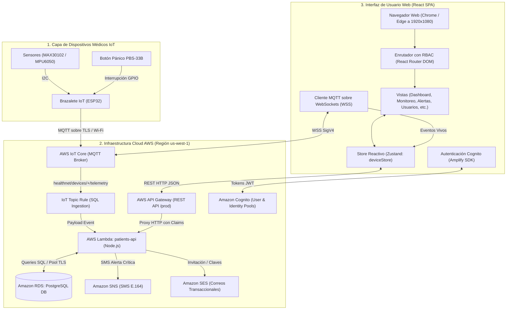
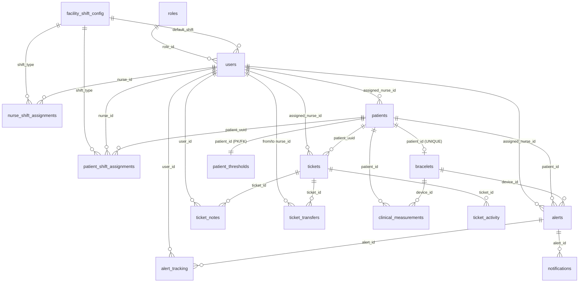
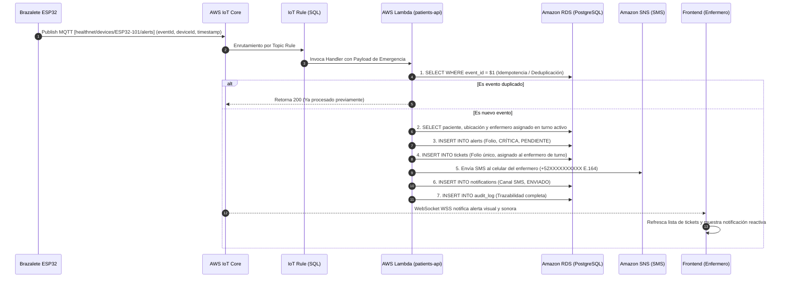

# DOCUMENTACIÓN TÉCNICA DEL SISTEMA HEALTHNET
**Arquitectura, Tecnologías, Base de Datos, Infraestructura Serverless y Comunicación**  
*Versión:* 1.0.0  
*Fecha:* Noviembre 2026  

---

## 1. ARQUITECTURA GENERAL DEL SISTEMA

### 1.1. Patrón Arquitectónico
HealthNet implementa una **Arquitectura Híbrida Orientada a Eventos y Microservicios Serverless**, compuesta por tres capas principales:

1. **Capa Cliente (Frontend SPA)**: Aplicación web de página única (*Single Page Application*) desarrollada en React 18 con TypeScript y empaquetada mediante Vite. Gestiona el renderizado declarativo, el estado reactivo con Zustand y la comunicación dual hacia AWS IoT Core (telemetría en vivo vía WebSockets) y hacia AWS API Gateway (peticiones transaccionales REST).
2. **Capa de Integración y Cómputo Nube (AWS Serverless)**:
   * **AWS IoT Core**: Broker MQTT para ingestión bidireccional de telemetría y eventos de brazaletes IoT vía TLS/WSS.
   * **AWS API Gateway (HTTP/REST)**: Puerta de enlace con autenticación delegada que canaliza solicitudes hacia la función Lambda.
   * **AWS Lambda (`patients-api`)**: Controlador monolítico serverless en Node.js que ejecuta la lógica de negocio, validaciones RBAC, sanitización y acceso a base de datos.
   * **Amazon SNS & SES**: Servicios de notificación multicanal para despacho de SMS ante emergencias y correos transaccionales.
3. **Capa de Persistencia (Amazon RDS PostgreSQL)**: Base de datos relacional transaccional estructurada bajo el esquema maestro v9.0, con preservación histórica, índices B-Tree y restricciones de integridad referencial.

### 1.2. Diagrama de Arquitectura de la Solución



---

## 2. ESTRUCTURA DEL CÓDIGO FUENTE Y ORGANIZACIÓN MODULAR

El repositorio sigue una organización modular limpia, separando la infraestructura y funciones Lambda en `aws/` y la aplicación cliente en `src/`:

```
HealthNet/
├── aws/                                       # Código de infraestructura y Lambda
│   ├── cloudformation_healthnet_stack.yaml    # Plantilla IaC de recursos AWS
│   ├── deploy_all.ps1 / deploy_all.sh         # Automatización de despliegue
│   ├── esp32_firmware.ino                     # Firmware C++ de brazaletes ESP32
│   ├── healthnet_database_schema_master.sql   # Esquema SQL definitivo PostgreSQL v9.0
│   └── lambdas/
│       └── patients-api/
│           ├── index.js                       # Controlador y Router API REST / IoT
│           └── package.json                   # Dependencias de la Lambda (pg, etc.)
│
└── src/                                       # Aplicación Frontend React SPA
    ├── assets/                                # Imágenes institucionales e iconos
    ├── components/                            # Componentes de presentación reutilizables
    │   ├── ChangePasswordModal.tsx            # Actualización segura de credenciales
    │   ├── DeviceCard.tsx                     # Tarjeta clínica de paciente en Dashboard
    │   ├── DeviceReportTemplate.tsx           # Plantilla HTML para generación de PDF
    │   ├── Logo.tsx                           # Identidad gráfica vectorial
    │   ├── LogoutConfirmModal.tsx             # Modal de confirmación obligatoria al salir
    │   ├── Navbar.tsx                         # Barra superior de navegación y alertas
    │   ├── ProtectedRoute.tsx                 # Guardián de rutas con validación RBAC
    │   ├── Sidebar.tsx                        # Menú lateral colapsable / expandible
    │   ├── TablePagination.tsx                # Control de paginación (10/30/50/100)
    │   └── charts/                            # Gráficas clínicas (Recharts)
    │       ├── HeartRateChart.tsx             # Curva de pulso cardíaco
    │       └── TempChart.tsx                  # Curva de temperatura corporal
    │
    ├── config/
    │   └── aws.ts                             # Configuración y detección de variables AWS
    ├── hooks/
    │   └── useAuth.ts                         # Custom hook de autenticación y rol
    ├── pages/                                 # Vistas de la aplicación
    │   ├── AlertsPage.tsx                     # Tickets clínicos, filtros y paginación
    │   ├── DashboardPage.tsx                  # Tableros según rol (Estratégico / Clínico)
    │   ├── LoginPage.tsx                      # Formulario de inicio de sesión
    │   ├── MonitoringPage.tsx                 # Directorio de telemetría y reportes PDF
    │   ├── ProfilePage.tsx                    # Expediente de pacientes y brazaletes
    │   ├── SimulatorPage.tsx                  # Consola del Simulador IoT (Admin)
    │   └── UsersManagementPage.tsx            # Usuarios, programación y turnos
    │
    ├── services/                              # Capa de comunicación e integración
    │   ├── auth.ts                            # Servicio de autenticación y usuarios
    │   ├── iot.ts                             # Cliente MQTT sobre WebSockets de AWS IoT
    │   ├── patientAssignmentService.ts        # Asignación territorial de pacientes
    │   ├── patients.ts                        # Cliente HTTP de API REST de pacientes
    │   ├── shiftService.ts                    # Matriz de turnos y validación de choques
    │   └── simulator.ts                       # Generador de telemetría sintética local
    │
    ├── store/
    │   └── deviceStore.ts                     # Store central reactivo (Zustand)
    ├── tests/                                 # Pruebas automatizadas (Vitest)
    │   ├── dataIntegrity.test.ts              # Integridad de telemetría real vs simulada
    │   ├── kpiCalculations.test.ts            # Cálculo de promedios médicos
    │   ├── phoneValidator.test.ts             # Validación de formato E.164
    │   └── shiftService.test.ts               # Validación de solapamiento de turnos
    ├── types/
    │   └── index.ts                           # Modelos de datos y permisos RBAC
    └── utils/
        ├── auditLogger.ts                     # Trazabilidad y bitácora de acciones
        └── phoneValidator.ts                  # Normalizador telefónico estándar E.164
```

---

## 3. ESPECIFICACIÓN DE LA BASE DE DATOS RELACIONAL (POSTGRESQL)

La base de datos relacional está optimizada para **PostgreSQL 13+** en **Amazon RDS**, estructurada bajo el archivo maestro idempotente `aws/healthnet_database_schema_master.sql`.

### 3.1. Principios de Diseño
1. **Identificadores Únicos Universales (UUID v4)**: Se utiliza `uuid_generate_v4()` para llaves primarias en tablas maestras, garantizando unicidad y evitando ataques de enumeración.
2. **Preservación Histórica Estricta**: No se realizan borrados destructivos en cascada (`ON DELETE CASCADE`) en entidades principales. Se aplica `ON DELETE SET NULL` o `ON DELETE RESTRICT` para salvaguardar la trazabilidad médica.
3. **Archivado Clínico y Suspensión Administrativa**:
   * En `patients`: Se implementa archivado clínico (`is_archived`, `archived_at`, `archived_by`, `archived_reason`).
   * En `users`: Se implementa suspensión administrativa (`is_active = FALSE`, `suspended_at`, `suspended_by`, `suspended_reason`).
4. **Desacoplamiento de Hardware IoT**: La tabla `bracelets` maneja el ciclo de vida del hardware de forma independiente al expediente del paciente mediante estados (`DISPONIBLE`, `ASIGNADO`, `MANTENIMIENTO`, `NO_EN_USO`).

### 3.2. Diagrama Entidad-Relación (ERD)



### 3.3. Diccionario de Tablas del Esquema Maestro

| Tabla | Clave Primaria | Claves Foráneas | Propósito Clínico / Técnico |
| :--- | :--- | :--- | :--- |
| `roles` | `id` (VARCHAR) | Ninguna | Catálogo RBAC: `admin`, `doctor`, `nurse`. |
| `facility_shift_config` | `id` (VARCHAR) | Ninguna | Horarios de atención: `matutino` (07-15), `vespertino` (15-23), `nocturno` (23-07). |
| `users` | `id` (UUID) | `role_id` $\rightarrow$ `roles(id)`<br>`default_shift` $\rightarrow$ `facility_shift_config(id)` | Directorio de personal, teléfonos E.164 y columnas de suspensión administrativa. |
| `patients` | `id` (UUID) | `assigned_nurse_id` $\rightarrow$ `users(id)` | Expediente clínico, ubicación (piso/habitación/cama) y columnas de archivado clínico. |
| `bracelets` | `device_id` (VARCHAR) | `patient_id` $\rightarrow$ `patients(id)` (UNIQUE) | Hardware IoT desacoplado (`DISPONIBLE`, `ASIGNADO`, etc.). |
| `patient_thresholds` | `patient_id` (UUID) | `patient_id` $\rightarrow$ `patients(id)` | Umbrales médicos de FC y temperatura calibrados exclusivamente por el Doctor. |
| `clinical_measurements`| `id` (BIGSERIAL) | `patient_id` $\rightarrow$ `patients(id)`<br>`device_id` $\rightarrow$ `bracelets(device_id)` | Registro histórico de telemetría viva (pulso, temperatura, acelerómetro, caídas). |
| `nurse_shift_assignments`| `id` (UUID) | `nurse_id` $\rightarrow$ `users(id)`<br>`shift_type` $\rightarrow$ `facility_shift_config(id)` | Programación semanal de turnos con restricción de unicidad `uq_nurse_week`. |
| `patient_shift_assignments`| `id` (UUID) | `nurse_id` $\rightarrow$ `users(id)`<br>`patient_uuid` $\rightarrow$ `patients(id)` | Asignación territorial de hasta 3 enfermeros por paciente (uno por cada turno semanal). |
| `alerts` | `id` (UUID) | `patient_id` $\rightarrow$ `patients(id)`<br>`device_id` $\rightarrow$ `bracelets(device_id)` | Alertas fisiológicas y de hardware generadas por sensores o pulsador PBS-33B. |
| `alert_tracking` | `id` (BIGSERIAL) | `alert_id` $\rightarrow$ `alerts(id)`<br>`user_id` $\rightarrow$ `users(id)` | Bitácora de seguimiento clínico y cambio de estado de la alerta. |
| `notifications` | `id` (BIGSERIAL) | `alert_id` $\rightarrow$ `alerts(id)`<br>`recipient_user_id` $\rightarrow$ `users(id)`| Despacho y estado de entrega de mensajería SMS a teléfonos de enfermeros. |
| `tickets` | `id` (UUID) | `assigned_nurse_id` $\rightarrow$ `users(id)`<br>`patient_uuid` $\rightarrow$ `patients(id)` | Ticket de atención formal con folio único, turno, criticidad y notas de resolución. |
| `ticket_notes` | `id` (BIGSERIAL) | `ticket_id` $\rightarrow$ `tickets(id)`<br>`user_id` $\rightarrow$ `users(id)` | Notas acumulativas inmutables añadidas durante la atención del paciente. |
| `ticket_transfers` | `id` (BIGSERIAL) | `ticket_id` $\rightarrow$ `tickets(id)`<br>`from/to_nurse_id` $\rightarrow$ `users(id)` | Historial inmutable de entregas formales de tickets entre enfermeros en cambio de turno. |
| `ticket_activity` | `id` (BIGSERIAL) | `ticket_id` $\rightarrow$ `tickets(id)` | Línea de tiempo cronológica de auditoría de cada modificación sobre el ticket. |
| `audit_log` | `id` (BIGSERIAL) | Ninguna (Desacoplada) | Bitácora de auditoría informática general con almacenamiento de cambios en JSONB. |

---

## 4. COMUNICACIÓN FRONTEND, BACKEND Y ENDPOINTS REST

La función backend `aws/lambdas/patients-api/index.js` expone una API RESTful servida a través de AWS API Gateway. Cada solicitud valida el rol del invocador y soporta paginación por parámetros de consulta (`query parameters`).

### 4.1. Catálogo de Endpoints RESTful Implementados

| Método | Ruta | Rol Autorizado | Parámetros Query / Body | Descripción y Códigos de Respuesta |
| :---: | :--- | :---: | :--- | :--- |
| `GET` | `/patients` | Todos (`admin`, `doctor`, `nurse`) | `?page=1&limit=10` | Consulta el catálogo de pacientes. Enfermeros consultan solo asignados. Retorna 200 con `X-Total-Count`. |
| `GET` | `/patients/{deviceId}` | Todos | Ninguno | Obtiene el perfil clínico y umbrales de un paciente por su identificador. Retorna 200 o 404. |
| `POST` | `/patients` | Solo `admin` | JSON con datos personales y de contacto | Registra un nuevo paciente en la base de datos. Retorna 201 Created o 403 Forbidden. |
| `PUT` | `/patients/{deviceId}` | `admin` (datos) / `doctor` (umbrales) / `nurse` (somatometría) | JSON con campos a actualizar | Actualiza datos del paciente según la matriz RBAC. Retorna 200 OK o 403 Forbidden. |
| `PUT` | `/patients/{deviceId}/archive` | Solo `admin` | `{"reason": "string"}` | Archiva clínicamente al paciente sin eliminar datos históricos. Retorna 200 OK. |
| `PUT` | `/patients/{deviceId}/unarchive` | Solo `admin` | Ninguno | Reactiva a un paciente archivado devolviéndolo al catálogo activo. Retorna 200 OK. |
| `GET` | `/alerts` | Todos | `?page=1&limit=10` | Lista histórica de alertas con criticidad y estado. Retorna 200 con `X-Total-Count`. |
| `POST` | `/alerts/emergency` | Todos / IoT Broker | `{"deviceId", "eventId", "timestamp"}` | Ingestión directa del pulsador PBS-33B con deduplicación por `eventId`. Retorna 201 o 200 (si es duplicado). |
| `PUT` | `/alerts/{alertId}/acknowledge` | Solo `nurse` asignado | Ninguno | Marca la alerta como atendida. Doctores y administradores reciben 403 Forbidden. Retorna 200. |
| `GET` | `/tickets` | Todos | `?page=1&limit=10` | Lista de tickets clínicos con notas y entregas de turno asociadas. Retorna 200 con `X-Total-Count`. |
| `POST` | `/tickets/{id}/notes` | Solo `nurse` asignado | `{"text": "string"}` | Añade una nota inmutable a la bitácora del ticket. Retorna 201 Created o 403 Forbidden. |
| `PUT` | `/tickets/{id}/status` | Solo `nurse` asignado | `{"status", "resolutionNotes"}` | Cambia el estado del ticket a `en_progreso` o `completado`. Retorna 200 OK. |
| `POST` | `/tickets/{id}/transfer` | Solo `nurse` asignado | `{"toNurseId", "toShiftType", "reason"}` | Entrega formal del ticket a otro enfermero registrando la transferencia. Retorna 201. |
| `GET` | `/users` | Solo `admin` | `?page=1&limit=10` | Padrón de usuarios y personal clínico. Doctores y enfermeros reciben 403. Retorna 200 con `X-Total-Count`. |
| `POST` | `/users` | Solo `admin` | `{"fullName", "email", "phoneNumber", "role"}` | Crea un nuevo usuario y emite invitación vía SES. Retorna 201 Created. |
| `PUT` | `/users/{id}/status` | Solo `admin` | `{"isActive", "suspendedReason"}` | Suspende o reactiva el acceso de un usuario. Retorna 200 OK. |
| `GET` | `/audit-logs` | `admin` y `doctor` | `?page=1&limit=10` | Consulta de la bitácora de auditoría general. Enfermeros reciben 403 Forbidden. Retorna 200. |
| `GET` | `/measurements` | Todos | `?deviceId=&range=hoy|semana|mes` | Telemetría fidedigna de constantes vitales almacenadas en RDS. Retorna 200 OK. |
| `ALL` | `/simulator` | Solo `admin` | Ninguno | Acceso al simulador IoT. Doctores y enfermeros reciben estrictamente **403 Forbidden**. Retorna 200 para Admin. |

### 4.2. Flujo de Datos de un Evento de Emergencia (Pulsador PBS-33B)



---

## 5. INTEGRACIÓN Y CONFIGURACIÓN DE SERVICIOS EN AWS

### 5.1. Estado de Configuración de los Servicios de AWS

| Servicio | Componente en Código | Configuración Real y Estado Actual |
| :--- | :--- | :--- |
| **AWS IoT Core** | `src/services/iot.ts` | **Implementado.** Cliente WebSockets (`wss://`) con autenticación SigV4. Se suscribe a `healthnet/devices/+/telemetry` y `healthnet/devices/+/alerts`. |
| **Amazon Cognito** | `src/config/aws.ts`<br>`src/services/auth.ts` | **Implementado en código.** Integra `Auth.signIn`, `Auth.signOut` y obtención de credenciales federadas para IoT. Dispone de modo demo fallback si las variables no están presentes. |
| **AWS API Gateway** | `src/services/patients.ts`<br>`aws/lambdas/patients-api` | **Implementado en código.** Enrutamiento proxy configurado con manejo de cabeceras CORS (`Access-Control-Allow-Origin: *`) y métodos HTTP estándar. |
| **AWS Lambda** | `aws/lambdas/patients-api/index.js` | **Implementado en código.** Función Node.js con router modular, conexión mediante pool `pg` con SSL (`rejectUnauthorized: false`), control RBAC y deduplicación. |
| **Amazon RDS (PostgreSQL)** | `aws/healthnet_database_schema_master.sql` | **Preparado / Pendiente de Despliegue Activo.** Esquema maestro v9.0 listo para ejecución. La instancia cloud previa se encuentra inactiva (fallo de resolución DNS). |
| **Amazon SNS (End User Messaging)** | `aws/lambdas/patients-api/index.js` (Función `sendSmsAlert`) | **Implementado en código.** Valida números en estándar E.164 y despacha SMS vía SNS Client. Si `SNS_ENABLED` no está activa, simula en logs para evitar cargos accidentales. |
| **Amazon SES** | `aws/setup_ses_route53.sh` | **Preparado en código.** Lógica de invitación de usuarios y reseteo administrativo de contraseñas. Requiere identidades de dominio verificadas en SES. |
| **AWS CloudFormation** | `aws/cloudformation_healthnet_stack.yaml` | **Preparado.** Define la infraestructura base: VPC (`10.0.0.0/16`), 2 subredes privadas, 2 subredes públicas, Internet Gateway, tablas de ruteo y grupos de seguridad. |

### 5.2. Infraestructura de Redes y Seguridad en AWS
* **VPC y Subredes**: La base de datos RDS reside en subredes privadas aisladas del tráfico público de internet.
* **Security Groups**: El grupo de seguridad de la base de datos permite tráfico entrante en el puerto `5432` exclusivamente desde el Security Group asignado a la función Lambda.
* **IAM Role de Ejecución Lambda**: Configurado con permisos de red `AWSLambdaVPCAccessExecutionRole`, acceso a CloudWatch Logs y políticas en línea mínimas para publicación en SNS (`sns:Publish`) y envío de correos en SES (`ses:SendEmail`).
