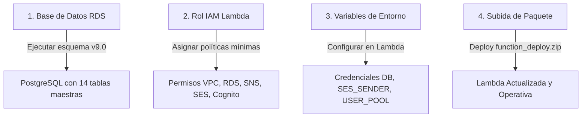

# PLAN DE IMPLEMENTACIÓN Y DESPLIEGUE — FUNCIÓN AWS LAMBDA (`patients-api`)
**Guía de Migración, Empaquetado, Configuración de Entorno, Pruebas y Rollback**  
*Versión:* 2.0.0 (Actualizada para Frontend v1.0.0 y Esquema DB v9.0)  
*Fecha:* Noviembre 2026  
*Función Objetivo:* `healthnet-patients-api` (AWS Lambda - Node.js 20.x / 18.x en Región `us-west-1`)  

---

## 1. RESUMEN EJECUTIVO Y ANÁLISIS COMPARATIVO

### 1.1. Contexto de la Migración
La versión anterior desplegada en AWS Lambda correspondía a un prototipo inicial básico (archivo `healthnet-patients-api-9bf59591-0e40-4510-a7c4-8a1208125b10.zip` de 252 líneas de código), el cual interactuaba con un esquema de base de datos plano y obsoleto, carecía de control de acceso por roles (RBAC), no soportaba el ciclo de vida de tickets clínicos, no contaba con deduplicación de alertas ni integración multicanal con SNS y SES, y carecía de restricciones sobre el Simulador IoT y la paginación.

La nueva versión desarrollada ([aws/lambdas/patients-api/index.js](file:///c:/Users/DELL/Desktop/leli/Uni/Huevo%20revuelto/Popochitos/HealthNet/aws/lambdas/patients-api/index.js) con más de 2,700 líneas) incorpora la totalidad de las reglas de negocio implementadas en el frontend, la integración con el esquema de base de datos relacional maestro v9.0 y las directivas de seguridad clínica exigidas.

### 1.2. Matriz Comparativa: Versión Anterior vs. Nueva Versión

| Capacidad / Endpoint | Versión Anterior (ZIP Prototipo) | Nueva Versión (Código Actual) | Impacto en la Aplicación Web |
| :--- | :---: | :---: | :--- |
| **Volumen de Código** | 252 líneas (~8 KB) | 2,703 líneas (~111 KB) | Arquitectura modular robusta y desacoplada. |
| **Control de Acceso (RBAC)** | ❌ Ninguno (Cualquier cliente podía invocar cualquier acción) | ✅ Estricto por Claims Cognito (`admin`, `doctor`, `nurse`) | Impide escalamiento de privilegios y accesos no autorizados. |
| **Manejo de Cuentas Suspendidas** | ❌ Inexistente | ✅ Bloqueo inmediato HTTP 403 si `is_active = false` | Impide que personal desvinculado opere el sistema. |
| **Pulsador de Emergencia PBS-33B** | ❌ No soportado | ✅ Procesador con Deduplicación (Idempotencia) | Genera ticket y alerta en milisegundos sin duplicidad. |
| **Ciclo de Vida de Tickets** | ❌ No existía tabla ni endpoints de tickets | ✅ Folio único, notas acumulativas, entregas de turno | Trazabilidad médica completa de incidentes. |
| **Preservación Histórica** | ⚠️ Borrado destructivo físico (`DELETE FROM patients`) | ✅ Archivado Clínico (`is_archived = true`) sin pérdida | Cumplimiento de preservación de expedientes médicos. |
| **Despacho SMS (Amazon SNS)** | ❌ No implementado | ✅ Despacho con validación telefónica E.164 | Alerta inmediata a celulares de enfermeros de guardia. |
| **Notificaciones Email (Amazon SES)** | ❌ No implementado | ✅ Envío transaccional a enfermero y administradores | Respaldo formal de emergencias en bandejas de entrada. |
| **Gestión de Personal (`/users`)** | ❌ Inexistente | ✅ Padrón, invitaciones Cognito, reseteo de claves | Administración integral de cuentas desde la plataforma. |
| **Gestión y Rotación de Turnos** | ❌ Inexistente | ✅ Horarios, programación semanal y matriz de camas | Prevención de huecos de cobertura asistencial. |
| **Restricción del Simulador IoT** | ❌ Inexistente | ✅ Bloqueo forzoso HTTP 403 para Doctor y Enfermero | Exclusividad absoluta para la Administración. |
| **Soporte de Paginación** | ❌ Inexistente (cargas planas sin límite) | ✅ `?page=X&limit=Y` con cabecera `X-Total-Count` | Rendimiento óptimo en listados con cientos de registros. |
| **Telemetría Histórica** | ❌ Inexistente | ✅ Endpoint `/measurements` fidedigno desde RDS | Cumplimiento de la Regla de Oro (cero datos falsificados). |

---

## 2. REQUISITOS PREVIOS EN INFRAESTRUCTURA AWS

Antes de actualizar el código de la función Lambda, deben validarse los siguientes componentes en la cuenta de AWS:



### 2.1. Base de Datos Amazon RDS (PostgreSQL)
* La instancia de PostgreSQL en Amazon RDS debe estar en estado **Available** (activa y resolviendo por DNS).
* Se debe haber ejecutado previamente el script maestro [aws/healthnet_database_schema_master.sql](file:///c:/Users/DELL/Desktop/leli/Uni/Huevo%20revuelto/Popochitos/HealthNet/aws/healthnet_database_schema_master.sql) para garantizar la existencia de las 14 tablas (`roles`, `users`, `patients`, `bracelets`, `patient_thresholds`, `clinical_measurements`, `nurse_shift_assignments`, `patient_shift_assignments`, `alerts`, `alert_tracking`, `notifications`, `tickets`, `ticket_notes`, `ticket_transfers`, `ticket_activity`, `audit_log`).

### 2.2. Rol IAM de Ejecución de Lambda (`HealthNetLambdaExecutionRole`)
El rol asignado a la función debe poseer las siguientes políticas administradas e inline:
1. `AWSLambdaVPCAccessExecutionRole` (para crear interfaces de red ENI en la VPC de la base de datos).
2. **Política Inline de Servicios (`HealthNetServicesPolicy`)**:
   ```json
   {
     "Version": "2012-10-17",
     "Statement": [
       {
         "Effect": "Allow",
         "Action": [
           "sns:Publish"
         ],
         "Resource": "*"
       },
       {
         "Effect": "Allow",
         "Action": [
           "ses:SendEmail",
           "ses:SendRawEmail"
         ],
         "Resource": "*"
       },
       {
         "Effect": "Allow",
         "Action": [
           "cognito-idp:AdminCreateUser",
           "cognito-idp:AdminResetUserPassword",
           "cognito-idp:AdminGetUser"
         ],
         "Resource": "arn:aws:cognito-idp:us-west-1:*:userpool/*"
       },
       {
         "Effect": "Allow",
         "Action": [
           "iot:Publish",
           "iot:Receive"
         ],
         "Resource": "*"
       }
     ]
   }
   ```

### 2.3. Configuración de Red (VPC, Subredes y Security Groups)
* **VPC**: La Lambda debe residir en las mismas subredes privadas que la instancia RDS PostgreSQL.
* **Grupo de Seguridad**: El Security Group de la base de datos RDS debe autorizar tráfico entrante TCP en el puerto `5432` originado por el Security Group de la función Lambda.
* **Salida a Internet / Endpoints**: Dado que la Lambda requiere invocar Amazon SNS, SES y Cognito desde una VPC, debe contar con un **NAT Gateway** en la subred pública o con **VPC Endpoints** (PrivateLink) para `sns`, `email-smtp` / `ses` y `cognito-idp`.

---

## 3. CONFIGURACIÓN DE VARIABLES DE ENTORNO EN LAMBDA

La función Lambda requiere las siguientes variables de entorno para operar en producción:

| Variable | Ejemplo de Valor | Descripción y Comportamiento |
| :--- | :--- | :--- |
| `DB_HOST` | `healthnet-db.xxxx.us-west-1.rds.amazonaws.com` | Endpoint DNS de la instancia PostgreSQL en Amazon RDS. |
| `DB_USER` | `healthnet_admin` | Usuario administrador de la base de datos. |
| `DB_PASSWORD` | `TuContraseñaSegura123!` | Contraseña maestra de PostgreSQL. |
| `DB_NAME` | `healthnet_db` | Nombre de la base de datos relacional. |
| `DB_PORT` | `5432` | Puerto estándar de conexión PostgreSQL. |
| `AWS_REGION` | `us-west-1` | Región donde residen los recursos cloud. |
| `SES_SENDER_EMAIL` | `notificaciones@healthnet.click` | Correo electrónico verificado en Amazon SES para despacho de avisos. |
| `SNS_ENABLED` | `true` | Habilita el despacho real de mensajes SMS a celulares. |
| `USER_POOL_ID` | `us-west-1_xxxxxxxxx` | ID del User Pool de Amazon Cognito para aprovisionamiento de usuarios. |

---

## 4. PROCEDIMIENTO DE EMPAQUETADO (PACKAGING)

El paquete de despliegue consolidado ya ha sido generado y se ubica en:
📁 **`aws/lambdas/patients-api/function_deploy.zip`**

### ¿Cómo reconstruir el paquete manualmente si se realizan futuros cambios en `index.js`?

#### En Windows (PowerShell):
```powershell
cd "c:\Users\DELL\Desktop\leli\Uni\Huevo revuelto\Popochitos\HealthNet\aws\lambdas\patients-api"
$ProgressPreference = 'SilentlyContinue'
Compress-Archive -Path "index.js", "package.json", "package-lock.json", "node_modules" -DestinationPath "function_deploy.zip" -Force
```

#### En Linux / macOS (Bash):
```bash
cd aws/lambdas/patients-api
zip -r function_deploy.zip index.js package.json package-lock.json node_modules/
```

*Contenido del ZIP:*
* `index.js` (Controlador y Router de la API de 2,703 líneas).
* `package.json` y `package-lock.json`.
* `node_modules/` conteniendo la librería `pg` (node-postgres v8.11.3) y sus subdependencias.

---

## 5. ESTRATEGIA DE DESPLIEGUE EN AWS LAMBDA

Se contemplan dos métodos de despliegue según las herramientas disponibles:

### Método A: Despliegue Automatizado mediante AWS CLI (Recomendado)
Ejecutar el script provisto en el proyecto ([aws/deploy_lambda.sh](file:///c:/Users/DELL/Desktop/leli/Uni/Huevo%20revuelto/Popochitos/HealthNet/aws/deploy_lambda.sh)) o invocar el comando directamente:

```bash
aws lambda update-function-code \
  --function-name "healthnet-patients-api" \
  --zip-file "fileb://aws/lambdas/patients-api/function_deploy.zip" \
  --region "us-west-1"
```

A continuación, actualizar o confirmar las variables de entorno:
```bash
aws lambda update-function-configuration \
  --function-name "healthnet-patients-api" \
  --timeout 30 \
  --memory-size 512 \
  --environment "Variables={DB_HOST=healthnet-db-instance.chiooewk8fd8.us-west-1.rds.amazonaws.com,DB_USER=postgres,DB_PASSWORD=HealthNet2026Master!,DB_NAME=healthnet_db,DB_PORT=5432,AWS_REGION=us-west-1,SES_SENDER_EMAIL=notificaciones@healthnet.click,SNS_ENABLED=true,USER_POOL_ID=us-west-1_xxxxxxxxx}" \
  --region "us-west-1"
```

---

### Método B: Despliegue mediante la Consola Web de AWS
1. Inicie sesión en la **Consola de AWS** y navegue al servicio **Lambda** en la región **us-west-1**.
2. Seleccione la función existente: `healthnet-patients-api` (o el nombre configurado en su stack).
3. En la pestaña **Code**:
   * En la esquina superior derecha del panel de código, haga clic en el botón desplegable **Upload from** $\rightarrow$ seleccione **.zip file**.
   * Haga clic en **Upload**, seleccione el archivo `aws/lambdas/patients-api/function_deploy.zip` de su computadora y presione **Save**.
4. En la pestaña **Configuration**:
   * En **General configuration** $\rightarrow$ **Edit**: Asegure un **Timeout** de al menos `30 segundos` y **Memory** de `512 MB`.
   * En **Environment variables** $\rightarrow$ **Edit**: Ingrese las 9 variables de entorno detalladas en la Sección 3 de este documento.

---

## 6. CONFIGURACIÓN EN AMAZON API GATEWAY

Para que las nuevas rutas sean consumibles por el frontend, verifique la configuración en **Amazon API Gateway**:

1. **Recurso Proxy Codicioso (Greedy Proxy)**:
   * La API debe contar con un recurso `/{proxy+}` configurado con el método `ANY` integrado mediante **Lambda Proxy Integration** apuntando a `healthnet-patients-api`.
2. **Configuración de CORS**:
   * Permitir los métodos: `GET, POST, PUT, DELETE, OPTIONS`.
   * Permitir las cabeceras: `Content-Type, Authorization, X-Amz-Date, X-Api-Key, X-Amz-Security-Token, X-User-Role, X-User-Id, X-User-Email`.
   * Origen: `*` (o el dominio web del frontend).
3. **Despliegue de la API**:
   * Cada vez que se modifica API Gateway, se debe hacer clic en **Actions** $\rightarrow$ **Deploy API** seleccionando la etapa (`Stage`): **`prod`**.

---

## 7. CONFIGURACIÓN DE LA REGLA EN AWS IOT CORE (BOTÓN PBS-33B)

Para que el pulsador físico de pánico despache la alerta en milisegundos directamente hacia la Lambda sin pasar por el navegador:

1. Ingrese a **AWS IoT Core** $\rightarrow$ **Message routing** $\rightarrow$ **Rules**.
2. Cree una regla con los siguientes datos:
   * **Nombre de la Regla**: `HealthNetEmergencyButtonRule`
   * **Sentencia SQL**:
     ```sql
     SELECT *, topic() AS topic FROM 'healthnet/devices/+/alerts' WHERE emergencyButtonPressed = true OR eventType = 'EMERGENCY_BUTTON'
     ```
   * **Acción**: *Lambda* $\rightarrow$ Seleccionar `healthnet-patients-api`.
3. Esto invocará directamente la función `processEmergencyEvent` de la Lambda, deduplicando por `eventId` y enviando los SMS/Emails de inmediato.

---

## 8. PLAN DE PRUEBAS Y VALIDACIÓN POST-DESPLIEGUE (SMOKE TESTING)

Una vez desplegada la función, ejecute las siguientes validaciones para certificar su correcto funcionamiento:

### Prueba 1: Verificación de Estado y Base de Datos (GET /patients)
```bash
curl -X GET "https://TU_API_GATEWAY_URL/prod/patients?page=1&limit=5" \
  -H "X-User-Role: admin" \
  -H "X-User-Email: admin@healthnet.com"
```
* **Resultado Esperado**: Código HTTP `200 OK`, cabecera `X-Total-Count` con el total de pacientes en base de datos, y un arreglo JSON con los primeros 5 pacientes.

---

### Prueba 2: Validación de Seguridad RBAC en el Simulador (Control Doctor)
```bash
curl -X GET "https://TU_API_GATEWAY_URL/prod/simulator/status" \
  -H "X-User-Role: doctor" \
  -H "X-User-Email: doctor@healthnet.com"
```
* **Resultado Esperado**: Código HTTP `403 Forbidden` con el mensaje:
  > *"Acceso Denegado (RBAC): El simulador IoT está restringido exclusivamente a la Administración..."*

---

### Prueba 3: Idempotencia y Deduplicación del Pulsador PBS-33B
Ejecutar dos veces seguidas la misma solicitud con el mismo `eventId`:
```bash
curl -X POST "https://TU_API_GATEWAY_URL/prod/alerts/emergency" \
  -H "Content-Type: application/json" \
  -H "X-User-Role: admin" \
  -d '{"deviceId":"ESP32-101","eventId":"TEST-EV-001","timestamp":1700000000000}'
```
* **Primera Petición**: Retorna HTTP `201 Created` con el folio generado (`TCK-...`), ticket creado y notificación SMS/Email enviada.
* **Segunda Petición**: Retorna HTTP `200 OK` con `isDuplicate: true` y el mensaje *"Evento de emergencia ya registrado previamente (idempotencia confirmada)"*, sin duplicar tickets ni saturar de SMS al personal.

---

## 9. PLAN DE CONTINGENCIA Y ROLLBACK (PLAN DE REVERSIÓN)

Si se detectara alguna inconsistencia crítica durante la puesta en marcha:

1. **Reversión de Código Inmediata**:
   * El archivo original de respaldo cargado por el usuario (`healthnet-patients-api-9bf59591-0e40-4510-a7c4-8a1208125b10.zip`) se encuentra respaldado de manera segura en el almacenamiento de scratch del proyecto.
   * Se puede restaurar el código anterior inmediatamente con el comando:
     ```bash
     aws lambda update-function-code \
       --function-name "healthnet-patients-api" \
       --zip-file "fileb://scratch/old_lambda/healthnet-patients-api-9bf59591-0e40-4510-a7c4-8a1208125b10.zip" \
       --region "us-west-1"
     ```
2. **Resiliencia Automática en Frontend**:
   * La aplicación web cuenta con detección de fallos HTTP 500: si la base de datos o la Lambda reportan error de conexión, el frontend conmuta automáticamente a modo local contingente (`localStorage`), impidiendo que los usuarios se queden con pantallas en blanco o colapsos de interfaz.
