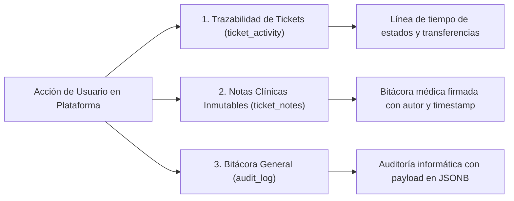

# SEGURIDAD WEB, CONTROL DE ACCESO Y PROTECCIÓN DE DATOS
**Mecanismos de Ciberseguridad, Gestión de Identidades (IAM/RBAC), Trazabilidad y Recomendaciones**  
*Versión:* 1.0.0  
*Fecha:* Noviembre 2026  

---

## 1. MODELO DE SEGURIDAD Y CONTROL DE ACCESO

HealthNet implementa una estrategia de **Defensa en Profundidad (Defense in Depth)** orientada a la protección de Información de Salud Protegida (PHI - *Protected Health Information*). El sistema no confía exclusivamente en restricciones visuales en el navegador, sino que exige validación de permisos en la capa de transporte, enrutamiento, controladores de API y base de datos relacional.

---

## 2. AUTENTICACIÓN Y GESTIÓN DE SESIONES

### 2.1. Proveedor de Identidad Cloud (Amazon Cognito)
* **Directorio de Cuentas (User Pools)**: HealthNet utiliza Amazon Cognito como proveedor de identidades centralizado para autenticación de usuarios clínicos y administrativos.
* **Tokens Criptográficos JWT**:
  * **IdToken**: Contiene los atributos del usuario, correo electrónico verificado y el claim personalizado `custom:role` (`admin`, `doctor` o `nurse`).
  * **AccessToken**: Token criptográfico firmado con algoritmo RS256 utilizado para autorizar peticiones REST contra AWS API Gateway.
  * **RefreshToken**: Permite la renovación transparente de sesiones sin forzar al personal médico a reintroducir sus credenciales en situaciones de emergencia.
* **Pool de Identidades Federadas (Identity Pools)**:
  * Provee credenciales temporales de AWS basadas en firma criptográfica SigV4 (Secret Access Key, Access Key ID y Session Token) para permitir que el cliente WebSockets en el navegador se conecte directamente al broker MQTT de AWS IoT Core con políticas mínimas de suscripción.

### 2.2. Modo Demostración y Contingencia Local
Para garantizar la continuidad operativa ante fallos de conexión a internet o demostraciones locales sin AWS:
* El servicio `src/services/auth.ts` detecta si las variables de entorno de Cognito están presentes (`isCognitoConfigured()`).
* Si no están presentes, opera de forma segura en modo local offline con usuarios precargados en memoria protegida, evitando bloqueos operativos.

### 2.3. Modal Obligatorio de Confirmación de Cierre de Sesión
Para prevenir cierres de sesión involuntarios durante rondas asistenciales:
* Todas las acciones de logout en [Sidebar.tsx](file:///c:/Users/DELL/Desktop/leli/Uni/Huevo%20revuelto/Popochitos/HealthNet/src/components/Sidebar.tsx) (versión expandida y mini-colapsada) y en [Navbar.tsx](file:///c:/Users/DELL/Desktop/leli/Uni/Huevo%20revuelto/Popochitos/HealthNet/src/components/Navbar.tsx) están interceptadas por el componente `LogoutConfirmModal.tsx`.
* La sesión se mantiene completamente activa si el usuario pulsa *Cancelar*, presiona la tecla `Escape` o hace clic fuera del diálogo.
* Al pulsar *Cerrar sesión*, se limpian los tokens en memoria y en almacenamiento del cliente, redirigiendo a la ruta `/login`.

---

## 3. AUTORIZACIÓN BASADA EN ROLES (RBAC)

El control de acceso basado en roles se implementa de manera sincronizada en dos capas:

### 3.1. Autorización en Frontend (Capa Cliente)
1. **Guardián de Rutas (`ProtectedRoute.tsx`)**:
   * Envuelve cada ruta protegida de la aplicación en `src/App.tsx`.
   * Verifica la existencia de una sesión válida (`user !== null`).
   * Valida si el rol del usuario forma parte del arreglo de roles permitidos (`allowedRoles`). Si no está autorizado, redirige automáticamente a `/dashboard` impidiendo la carga de la vista.
2. **Matriz de Permisos Tipada (`ROLE_PERMISSIONS` en `src/types/index.ts`)**:
   * Objeto inmutable tipado en TypeScript con más de 25 banderas booleanas de permisos asistenciales y administrativos.
   * Controla el renderizado condicional de botones, formularios y tablas (por ejemplo, deshabilitar la edición de datos personales a médicos y enfermeros, u ocultar la resolución de alertas a administradores).

### 3.2. Autorización en Backend (Capa AWS Lambda)
En `aws/lambdas/patients-api/index.js`, cada solicitud HTTP es evaluada de forma independiente a la interfaz gráfica:
1. **Extracción y Normalización de Identidad**:
   ```javascript
   const rawRole = headersLower['x-user-role'] || event.requestContext?.authorizer?.claims?.['custom:role'];
   const callerRole = rawRole ? rawRole.toLowerCase().trim() : null;
   ```
2. **Rechazo de Privilegios por Omisión**: Si una solicitud no incluye un rol válido (`admin`, `doctor`, `nurse`), se rechaza de inmediato:
   ```javascript
   if (!callerRole || !validRoles.includes(callerRole)) {
     return {
       statusCode: 401,
       headers,
       body: JSON.stringify({ message: 'No autorizado: Se requiere una identidad de usuario y rol clínico válido.' })
     };
   }
   ```
3. **Bloqueo Restrictivo del Simulador IoT**:
   * Si la ruta solicitada inicia con `/simulator`, el backend exige `callerRole === 'admin'`.
   * Peticiones ejecutadas por doctores o enfermeros son rechazadas con **HTTP 403 Forbidden**.
4. **Verificación de Cuentas Suspendidas en Base de Datos**:
   * La Lambda consulta la tabla `users`: si el registro tiene `is_active = FALSE`, se aborta la operación con **HTTP 403 Forbidden: Cuenta suspendida**.
   * Si el rol recibido en cabeceras no coincide con el registrado en la base de datos, se bloquea la petición por intento de escalamiento de privilegios.
5. **Segregación Asistencial de Tickets y Notas**:
   * Peticiones para añadir notas (`POST /tickets/{id}/notes`) o cambiar estados (`PUT /tickets/{id}/status`) enviadas por usuarios con rol `admin` o `doctor` son denegadas con **HTTP 403 Forbidden**, reservando la atención directa a enfermería.

---

## 4. VALIDACIÓN, SANITIZACIÓN Y PROTECCIÓN DE DATOS

### 4.1. Prevención de Inyecciones SQL (SQLi)
* Todas las consultas en la función Lambda hacia PostgreSQL se construyen mediante **sentencias preparadas parametrizadas** (`$1, $2, $3, ...`):
  ```javascript
  const result = await db.query(
    'SELECT * FROM patients WHERE id = $1 AND is_archived = $2',
    [patientId, false]
  );
  ```
* Se prohíbe la interpolación directa de cadenas en sentencias SQL, mitigando en su totalidad ataques de inyección SQL.

### 4.2. Validación Telefónica Internacional (Estándar E.164)
* En centros asistenciales, el despacho de alertas SMS a través de Amazon SNS requiere el cumplimiento del estándar internacional E.164.
* La utilidad [phoneValidator.ts](file:///c:/Users/DELL/Desktop/leli/Uni/Huevo%20revuelto/Popochitos/HealthNet/src/utils/phoneValidator.ts) valida con expresiones regulares y normaliza cualquier número ingresado (por ejemplo, `55 1234 5678` $\rightarrow$ `+525512345678`) antes de almacenarlo en la base de datos o enviarlo a la pasarela de mensajería.
* Se cuenta con una suite de pruebas unitarias (`src/tests/phoneValidator.test.ts`) que valida casos límite y formatos válidos/inválidos.

### 4.3. Prevención de Cross-Site Scripting (XSS)
* La aplicación se apoya en el escape automático de caracteres del motor de renderizado de React (JSX).
* En la exportación de plantillas HTML y previsualización de reportes se integra **DOMPurify** (`DOMPurify.sanitize()`) para sanitizar entradas textuales libres antes de insertarlas en el DOM.

### 4.4. Preservación Histórica y Protección de Expedientes (No-Destrucción)
* Siguiendo los principios éticos y normativos de confidencialidad y preservación de expedientes médicos:
  * No se ejecutan instrucciones destructivas `DELETE` sobre pacientes, telemetría o tickets.
  * El catálogo de pacientes utiliza **Archivado Clínico** (`is_archived = TRUE`) que oculta al paciente de la operación diaria pero conserva intactas todas sus mediciones históricas, caídas y notas previas.
  * En la base de datos relacional, las claves foráneas hacia pacientes y brazaletes utilizan `ON DELETE SET NULL` o `ON DELETE RESTRICT` para evitar pérdidas accidentales en cascada.

---

## 5. TRAZABILIDAD, AUDITORÍA Y REGISTRO DE ACTIVIDADES

HealthNet implementa auditoría en tres niveles independientes:



1. **Línea de Tiempo del Ticket (`ticket_activity`)**: Cada evento (`CREADO`, `ASIGNADO`, `EN_PROGRESO`, `NOTA_AGREGADA`, `TRANSFERENCIA`, `COMPLETADO`) se registra automáticamente con el usuario, rol y marca de tiempo inalterable.
2. **Notas Clínicas Inmutables (`ticket_notes`)**: Los comentarios y notas de cuidado redactados por enfermería son de solo lectura una vez guardados; no existe opción de edición o eliminación de notas registradas.
3. **Bitácora General del Sistema (`audit_log`)**: Almacena acciones administrativas críticas (altas de pacientes, suspensiones de cuentas, cambios de umbrales médicos, vinculación de brazaletes) incluyendo el estado previo y posterior en formato `JSONB`.

---

## 6. GESTIÓN DE VARIABLES DE ENTORNO Y CREDENCIALES

* **Exclusión de Secretos en Control de Versiones**: El archivo `.gitignore` excluye estrictamente `.env`, `.env.local` y archivos `.pem` o llaves de certificados.
* **Separación de Configuración Pública y Privada**:
  * En el frontend (Vite), solo se exponen variables con prefijo `VITE_` que corresponden a identificadores públicos de AWS (Región, User Pool ID, Client ID sin secreto, Endpoint de IoT Core).
  * Las credenciales de base de datos (`DB_HOST`, `DB_USER`, `DB_PASSWORD`) residen exclusivamente en las variables de entorno cifradas de la función AWS Lambda o en AWS Systems Manager Parameter Store.

---

## 7. RIESGOS IDENTIFICADOS Y RECOMENDACIONES DE MITIGACIÓN

| Riesgo Técnico / Vulnerabilidad | Nivel de Riesgo | Estado Actual | Medida Recomendada |
| :--- | :---: | :---: | :--- |
| **Cabeceras CORS Abiertas (`*`)** | Medio | Configurado `Access-Control-Allow-Origin: '*'` en la Lambda para facilitar pruebas. | Restringir el origen exclusivamente al dominio institucional en producción (`https://healthnet.tu-dominio.com`). |
| **Límite de Tasa de Peticiones (Rate Limiting)** | Medio | No existe límite de peticiones configurado en la API Gateway. | Implementar **AWS WAF** (Web Application Firewall) con reglas de *Rate Limiting* (p. ej. máximo 100 req/min por IP) para mitigar ataques DDoS y abusos. |
| **Sandbox de Amazon SNS** | Bajo | La cuenta de AWS se encuentra en modo Sandbox; solo envía SMS a números previamente verificados. | Solicitar a AWS Support el paso a producción de Amazon SNS para habilitar el despacho de alertas a cualquier número celular. |
| **DNS Inaccesible de Instancia RDS** | Alto | El endpoint configurado de RDS genera `ENOTFOUND` si la base de datos está detenida. | Desplegar el esquema consolidado v9.0 en una nueva instancia RDS activa con Multi-AZ para alta disponibilidad asistencial. |
| **Rotación Automática de Credenciales** | Bajo | Las credenciales de base de datos se configuran como variables fijas en Lambda. | Integrar **AWS Secrets Manager** con rotación automática de claves para el usuario de PostgreSQL. |
